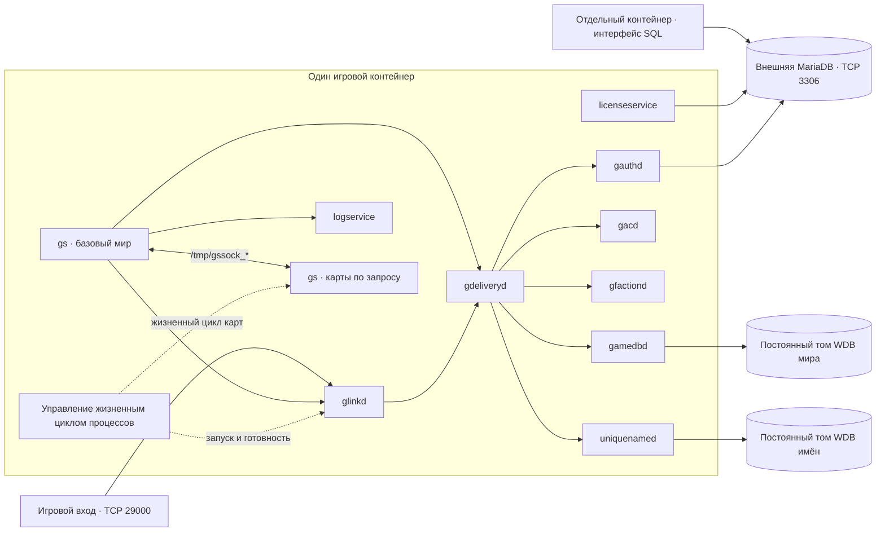

# Один игровой контейнер — вариант целевой схемы

Текущая гипотеза для обсуждения. Один игровой контейнер выполняет десять игровых программ, в том числе `gamedbd`, `uniquenamed` и нужное число экземпляров `gs`. Отдельный сервис MariaDB обслуживает обе SQL-схемы. Панели запускаются в собственных контейнерах. Файлы WDB мира и имён живут в отдельных постоянных томах, которыми владеют соответствующие нативные процессы. [Измеренные зависимости](runtime-contracts.ru.md) · [Варианты выноса хранилищ](storage-and-recovery.ru.md)

## Что даёт общий игровой контур

Общий loopback сохраняет локальные TCP-связи и адрес лицензии. Общий `/tmp` доступен процессам карт с их существующими UNIX-сокетами. Нужны управление запуском, адресное завершение дочерних процессов, вывод журналов и готовность на уровне нужных служб. Отдельные группы процессов ограничивают область действия группового сигнала. Сбой одного процесса может обрабатываться внутри игрового контура. За перезапуск всего контейнера отвечает внешний уровень. Возможность отдельно изменять масштаб и лимиты каждой службы уменьшается. [Сетевые контракты](runtime-contracts.ru.md)

Базой для первого запуска остаётся amd64 с glibc и ABI проверенных библиотек. Нативные игровые процессы используют ELF64. Комплектные утилиты обслуживания, включая ELF32 `dbtool` и `dbanlz`, можно выполнять в отдельном окружении с подходящей разрядностью. [Снимок среды](server-only-validation.ru.md#работающая-vm) · [Утилиты хранилищ](storage-and-recovery.ru.md#утилиты-комплекта-и-пределы-восстановления)

Исходный вариант сохраняет в постоянных томах `gamedbd/dbhome` и `uniquenamed/dbhome` целиком. Каждый том содержит `dbdata` и относящийся к нему журнал `dblogs`. Выделенный образ хранения возможен в виде штатных `gamedbd` и `uniquenamed` вместе с их томами. В сетевой пробе `uniquenamed` открыл базу и порт `29401`. Для работы всего выделенного контура нужно подтвердить запуск `gamedbd` и обмен GNET по `29400` и `29401`. [Хранилища и восстановление](storage-and-recovery.ru.md)

## Управление картами

При переходе на выгруженную карту игрок должен увидеть состояние загрузки, а сервер продолжить переход после готовности маршрута. Длительное ожидание допустимо. В `huzeming-176source/cgame/gs/player.cpp:3712–3718` отправка `SwitchServerStart` сопровождается запуском таймера. Обработчик `GM_MSG_HEARTBEAT` при его истечении отменяет переход (`:1355–1364`). Ожидание готовности карты нужно перед штатным переключением. Способ показать загрузку существующим клиентом требует отдельной проверки.

Выгрузка требует закрыть новые входы, учесть игроков и незавершённые переходы и подтвердить запись состояния. Готовность `gs` и безопасное завершение задаются игровым контрактом. Процессный supervisor выполняет запуск и остановку по сигналам этого контракта. [Маршрутизация, экземпляры и выгрузка](maps.ru.md)

Системные инструменты могут обслуживать процессы и журналы. SQL-интерфейс может работать по сети с MariaDB. Игровые операции панелей требуют собственного контракта RPC или отдельного посредника для вызова нативной команды. Панели остаются самостоятельными приложениями. [Матрица сценариев](panels-and-workflows.ru.md)

Схема описывает вариант развёртывания для следующего этапа. Такие контейнеры и автоматическое управление картами пока остаются гипотезой, а исходные серверные проверки выполнены в VM и WSL. [Результаты проверок](server-only-validation.ru.md)
