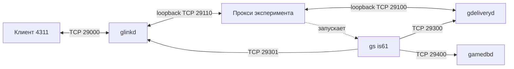

# Автозагрузка карты в Perfect World 1.7.6 Build 4311

## Условия

Оригинальные бинарники из раздачи, Debian VM, Windows-клиент 4311 и персонаж `test` (ID `1026`). Сохранённая точка находится на Террасе Сансары, карта `is61`, `worldtag=161`, ID процесса в маршрутизации `101`. [Исследование маршрутов карт](maps.ru.md)

## Контроль на штатном сервере

| Условие | Наблюдение |
|---|---|
| Выключена `is61`, работает `gs01` | При входе персонажем `gdeliveryd` записала `PlayerLogin wrong! … gs_id=-1 world_id=161`. Клиент показал «Ошибка входа в систему» и вернулся на экран логина. |
| `is61` запущена вручную | Карта зарегистрировалась примерно за 10 секунд. Повторный вход дал `gs_id=101` и `PlayerLogin_Re result=0`. Персонаж вернулся на Террасу Сансары. На экране загрузки мира был указан лимит 30 секунд. |

## Изменения на стенде

- В VM добавлен [стендовый скрипт](evidence/map-autoload.py) в `/root/pw-map-autoload-lab/map-autoload.py`. Он принимает внутренние сообщения шлюза на `127.0.0.1:29110` и передаёт их в `gdeliveryd` на `127.0.0.1:29100`. В копии конфига `/root/pw-map-autoload-lab/glinkd.conf` изменён только порт секции `[GDeliveryClient]`. Шлюз запускается с этим файлом из штатного рабочего каталога `/root/pwserver/glinkd`.
- На момент подготовки работают девять основных служб и скрипт стенда. Оба процесса `gs01` и `is61` остановлены. Внешний игровой порт `29000` слушает `glinkd`.
- Для `PlayerLogin` персонажа `1026` скрипт держит исходное сообщение до готовности `is61`. Полезная нагрузка передаётся целиком. Остальной обмен продолжается. Уход сессии или отмена очереди снимают ожидающий вход. По истечении 90 секунд скрипт отдаёт запрос штатному обработчику.
- `MapStartup.request(world_tag)` объединяет одновременные запросы запуска карты. Она запускает `gs is61` и ждёт регистрации в `world2.trace`, соединения этого PID со шлюзом на TCP `29301` и свежей записи `分配了世界` о выделении мира в `is61.log`. Для опыта адрес карты задан по ID персонажа.
- `gs` запускается из `/root/pwserver/gamed-map-autoload`. Каталог содержит ссылки на файлы `/root/pwserver/gamed` и копию `ptemplate.conf` с `[GENERAL] output_debug_info = active`. `stdbuf -oL` выводит диагностическую строку в журнал сразу после завершения строки.
- Шлюз и сервер работают с бинарниками раздачи. Отдельный конфиг шлюза хранится рядом со скриптом опыта. Задержку задаёт целое число секунд в `/root/pw-map-autoload-lab/delay-seconds`. Скрипт читает его перед запуском карты.

### Схема соединений

Через прокси проходит обмен `glinkd` с `gdeliveryd`. Клиент и процессы `gs` подключаются к штатным службам напрямую. Прокси удерживает вход персонажа `test` и после готовности карты пересылает исходный запрос без изменений.

В WSL проверены разбор сообщений, удержание входа до готовности, пересылка остальных сообщений и отмена ожидающего входа при отключении сессии. На VM подтверждены слушатели и оба внутренних TCP-соединения при нуле процессов `gs`.

## Версия клиента при запуске шлюза

Первый вход при свежем `glinkd` и нуле карт остановился на логине с сообщением «Старая версия клиента. Пожалуйста, обновите клиент». В исходниках S172 `AnnounceProviderID` передаёт шлюзу `edition`, который он затем включает в `Challenge`. В VM поле `Challenge.version` было равно `67334`, а `edition` было пустым.

После короткого запуска `is61` шлюз передал 34 байта в `edition`. Поле сохранилось байт в байт после остановки карты. Дальнейшие пробы начинаются при нуле процессов `gs` и уже инициализированной версии шлюза.

`edition` удалось вычислить без запуска карт. Это пять шестнадцатеричных чисел без разделителей и заполнения нулями. Значения читаются как 32-битные числа little-endian.

| Файл | Смещение | Значение |
|---|---|---|
| `elements.data` | 0 | `30000182` |
| `tasks.data` | 4 | `bf` |
| `gshop.data` | 0 | `63083353` |
| `gshop1.data` | 0 | `630837e0` |
| `gshop2.data` | 0 | `6308376b` |

Результат `30000182bf63083353630837e06308376b` совпал с ответом `Challenge` работающего шлюза. Для итогового запуска нужно подать вычисленное поле в шлюз до первого подключения клиента и до любого запуска `gs`. Источники формулы — H176 `instance_manager.cpp:31–44` и `gproviderclient.cpp:135–136`.

## Прогоны с клиентом

| Прогон | Начальное состояние | Результат |
|---|---|---|
| Запуск по входу | Нет процессов `gs`, задержка 0 с, пересылка сразу после регистрации | `is61` запустилась по одному нажатию. Через 8,15 с прошла регистрация и запрос ушёл в игру. База вернула роль, карта ответила `PlayerLogin_Re result=1`. Клиент показал «Ошибка входа в систему». |
| Повтор запуска | Нет процессов `gs`, задержка запуска 0 с, запас после регистрации 12 с | Регистрация через 8,51 с, пересылка исходного запроса через 20,59 с, `PlayerLogin_Re result=0`. До ответа кнопка «Войти» была серой. Затем клиент показал «Входим в игру» и загрузил Террасу Сансары. |
| Задержка больше 30 с | Нет запущенных карт, задержка запуска 40 с, запас после регистрации 12 с | Процесс запустился через 40 с, регистрация через 47,66 с, пересылка исходного запроса через 59,74 с. Ответ `PlayerLogin_Re result=0` получен для той же сессии `31`. Около 5 с спустя карта зафиксировала вход персонажа в мир. Игрок подтвердил успешный вход на Террасу Сансары. |
| Окно очереди | Нет запущенных карт, задержка запуска 40 с, начальная оценка 60 с | Клиент показал «Ожидание», «Сервер переполнен», «Место: 1» и «Время: 1 мин». Карта зарегистрировалась через 48,21 с. Исходный запрос переслан через 60,29 с, `PlayerLogin_Re result=0`, ещё примерно через 6 с персонаж вошёл в мир. |
| Без искусственных пауз, по регистрации | Нет запущенных карт, задержка и запас 0 с, обновление оценки раз в минуту | `gs` запустился сразу. Через 9,45 с регистрация и соединение уже были подтверждены. `gamedbd` вернула роль, а `gs` ответил `PlayerLogin_Re result=1`. Клиент показал «Ошибка входа в систему». Оценку 8 с штатное окно показало как «1 мин». |
| Без искусственных пауз, по выделению мира | Нет запущенных карт, задержка 0 с, ожидание свежей записи `分配了世界` | Регистрация через 8,48 с, выделение экземпляра через 18,53 с, пересылка запроса через 18,56 с. Отправлена одна оценка в 20 с. `PlayerLogin_Re result=0`, на Террасе Сансары через примерно 24 с от нажатия. Вход подтверждён журналом и снимком клиента. |

В `gs.conf` у `is61` включён `parallelworld_server=1`. В H176 `GetWorldOnLogin` выбирает среди активных копий, а `Heartbeat` добавляет копию на десятисекундном цикле. В 4311 строку `分配了世界` выводит `AllocWorldWithoutLock`. В пробном запуске с диагностикой эта строка появилась без входа персонажа. Прежние прогоны использовали фиксированный запас 12 секунд после регистрации.

Клиент 4311 дождался ответа на выбор персонажа почти минуту. Экран загрузки мира с таймером 30 секунд относится к следующему этапу. Верхний предел ожидания на экране выбора в этих прогонах не измеряли.

Журнал прототипа — `/root/pw-map-autoload-lab/relay.log`. Вывод карты находится рядом в `is61.log`, регистрация и `PlayerLogin_Re` — в `/root/pwserver/logs/world2.trace`, переход в мир — в `world2.log`. После прогона с окном очереди задержка запуска возвращена к 0 секундам.

## Выгрузка на экране выбора персонажа

После возврата `test` в меню персонажей `gdeliveryd` записала `RoleOffline(1026)`. Пустую `is61` остановили сигналом `SIGTERM`. Сразу после остановки и через 2 минуты 13 секунд активных процессов `gs` не было. Шлюз сохранил тот же клиентский TCP-сокет. Пользователь подтвердил, что остался в меню выбора и видел персонажа `test`.

## Окно ожидания

Пока холодная карта запускается, прокси отправляет `WaitQueueStateNotify` через `glinkd` ожидающему клиенту. Оценка складывается из заданной задержки запуска и ожидаемого времени до появления экземпляра. В прогоне с задержкой запуска 40 секунд начальная оценка составила 60 секунд, обновления отправлялись каждые 5 секунд.

Текущий скрипт отправляет первую оценку в начале ожидания и обновляет её раз в минуту. Клиент сам считает остаток и показывает «1 мин» для положительного остатка меньше минуты. Как только карта готова, прокси сразу передаёт исходный `PlayerLogin` в `gdeliveryd`.

В сообщении 4311 есть числовое поле `waittime` в секундах. Текст и подписи задаёт `interfaces.pck → interfaces/loginqueuenormal.xml`. Чтобы окно очереди показывало «Загружается карта», можно изменить этот ресурс клиента. Надпись тогда изменится и для штатной очереди по лимиту игроков. Разные тексты для двух причин ожидания потребуют различать эти причины на клиенте.

В тесте с двумя loopback-соединениями проверены уведомление при холодном входе, пересылка исходного запроса целиком, штатный ответ на отмену и вход без окна на прогретую карту.

### Чёрный экран входа в мир

После допуска персонажа клиент показывает `Win_EnterWait` с текстом из `interfaces.pck → interfaces/ingame.stf` (строки 515 и 516). В `elementclient_64.exe` Build 4311 вызов, запускающий таймер входа в мир, получает 30 000 мс. Клиент сравнивает прошедшее время с этим пределом и вызывает `CECGameSession::OnOvertimeHappen`. В бинарнике это видно у `0x140c04d0e` и `0x140c053d8`.

Оценку времени холодного запуска клиент получает на экране выбора персонажа. Чёрный экран с этой оценкой можно оформить в ресурсе окна очереди. Чтобы сам `Win_EnterWait` включался до готовности карты и ждал по оценке сервера, нужна доработка клиентской логики. В живом прогоне 60,29 с прошли до допуска персонажа. Истечение таймера на чёрном экране проверено по коду клиента.

## Вход без прокси

В бинарнике `gdeliveryd` Build 4311 `PlayerLogin::DoLogin` вызывает `WaitQueueManager::OnPlayerLogin` перед маршрутизацией. Очередь использует лимиты входящих и активных игроков. При допуске `WaitQueueManager::ContinueLogin` тоже вызывает `FindGameServer`. Для отсутствующей карты штатный путь вернул `gs_id=-1` и отказал во входе. Настройка или Lua-обработчик, который ждёт готовности нужной карты перед маршрутизацией, в проверенном пути не найдены.

При изменении `gdeliveryd` ожидание по `worldtag` и координатам можно добавить перед `FindGameServer` и продолжать вход после готовности карты через прямое соединение со шлюзом. Прокси позволяет проверить это поведение на имеющихся бинарниках.

## Общая операция для входа и телепорта

Вход ищет карту в `gdeliveryd` по сохранённым координатам и `worldtag`. В исходниках H176 исходный `gs` ищет целевой процесс телепорта через `PlaneSwitch` и `GetGlobalServer`. Он делает это до появления `SwitchServerStart`. В бинарнике 4311 `LuaManager::EventOnEnterServer` вызывается из `HwidPlayerData::Process`. Этот C++-метод проверяет HWID уже после назначения игрового процесса. Lua-вызовы в `gs` относятся к использованию предметов и запросам услуг. [Разбор маршрутов](maps.ru.md#переход-если-целевой-gs-ещё-не-запущен)

У обоих путей есть общий запрос «подготовь карту по тегу и позиции». Эксперимент проверяет его для одной карты и входа. Для телепорта тот же запуск можно вызвать из исходного `gs` перед маршрутизацией, дополнив проверку готовности его прямой связью с целевым процессом. Для мира с несколькими участками одного `worldtag` в запросе нужны координаты.

В бинарнике `gs` 4311 Lua-функция `game__PlayerTeleport` вызывает `gplayer_imp::LongJump`. Для перехода между разными `worldtag` он вызывает `world_manager::PlaneSwitch`. Это точка для контрольного вызова телепорта на тестовой роли.

## Клиентские ресурсы перед финальной сборкой

Контакты поддержки FightPW найдены в `interfaces.pck → interfaces/tips.txt`. Пакет интерфейсов рабочего клиента RuTracker побайтно совпадает с `Patch-client-1.7.6-ru` (SHA‑256 `469ddcdbb54f2eb475d94d7d7612a3fd3e617a8c7aad14d8a15389142f3d8354`). В оригинальном RU-клиенте 4311 в этом файле есть ссылка на официальное сообщество PW.

[Скриншот загрузочного экрана](evidence/client-loading-fightpw-tip.png) показывает ссылки на сообщества FightPW в VK и Telegram в подсказке клиента.

Для итоговой сборки проверить содержимое подключаемых PCK и происхождение изменённых ресурсов. В клиентском журнале сверить ошибки чтения, кодировку новостей, музыку создания персонажа и звуки анимаций. [Прежние наблюдения в клиенте](../rutracker-1.7.6-4311-usage.ru.md#первый-запуск)

### Неактивная кнопка «Создать персонажа»

При подготовке телепорта запустили `gs01` (`worldtag=1`). После повторной авторизации при работающей `gs01` кнопка «Создать персонажа» оставалась серой.

Клиент 4311 получил список с одной ролью. Проверка `Btn_Create` не прошла из-за восьми моделей редактора, оставшихся без инициализации. В журнале клиента восемь записей `CECPlayer::LoadPlayerModel,high poly model should not use this function`. С закрытым окном игры временно переключили `[Video] HighPoly` с `1` на `0` в `element/userdata/systemsettings.ini` для проверки запуска со стандартными моделями.

После перезапуска с `HighPoly = 0` кнопка стала активной, и в журнале нового процесса `EC_64_30884.log` эта ошибка не повторилась. Когда работала только `gs01`, пользователь создал мага первого уровня `tptest`. Сервер подтвердил создание роли `1027` в `DBCreateRole` и `PostCreateRole(success=1)`.

На экране выбора у существующего `test` после смены режима заметно изменились причёска и одежда. Перед финальной сборкой повторить создание персонажа и сравнить отображение одной и той же роли на оригинальном RU-клиенте 4311 при `HighPoly = 1` и `HighPoly = 0`. Если ошибка воспроизводится только у клиента из раздачи, сверить файлы моделей и их загрузку с оригиналом. Проверить исправление с включёнными улучшенными моделями.

## Возврат к штатному запуску

Когда в игре нет активных сессий, перезапустить `glinkd` с исходным `gamesys.conf 1` из его штатного каталога. После восстановления прямого соединения с `29100` остановить стендовый скрипт и при необходимости поднять `gs01` и `is61` штатными командами из `/root/pwserver/gamed`.

### Значок после закрытия окна

После закрытия окна пользователь заметил значок Perfect World в области уведомлений Windows. [Скриншот трея](evidence/client-after-close-tray-icon.png)
