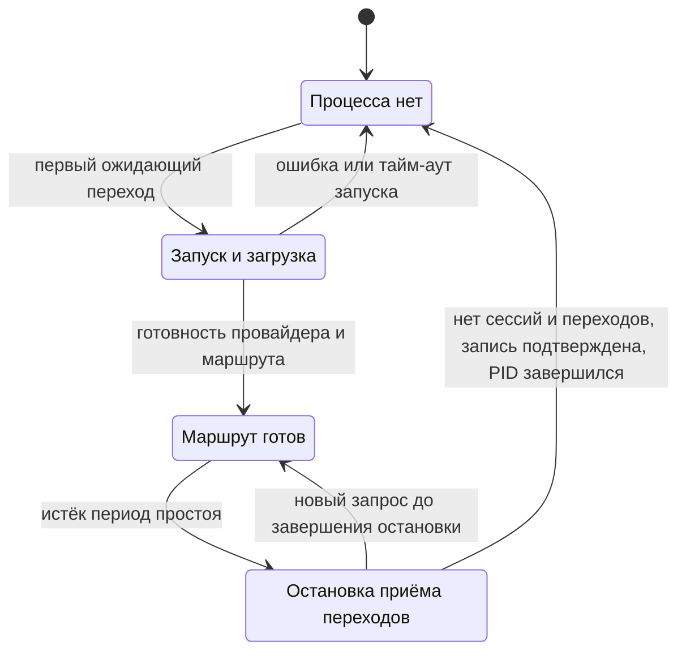

# Карты и переходы Perfect World 1.7.6 Build 4311

`gs` уже умеет создавать и освобождать копии подземелья внутри процесса. Запуск и остановка **процесса** для целой карты — отдельная задача. В раздаче процесс запускает внешний сценарий или панель. В доступном коде движка обычный телепорт ищет уже доступный `gs` на исходной карте и завершается с ошибкой, если его нет. Поэтому одного внешнего запускателя или настройки списка карт недостаточно для прозрачной автозагрузки по первому запросу.

Источники разделены по происхождению:

| Обозначение | Источник и границы |
| --- | --- |
| VM 4311 | [Наблюдения на рабочей VM](../rutracker-1.7.6-4311-architecture.ru.md), [предыдущая проверка входа](../rutracker-1.7.6-4311-usage.ru.md) и [отдельный запуск `is02`](evidence/map-probe-extended.json). |
| H176 | `GitHub/huzeming-176source`, `c0992a29`. Это доступный исходник движка 1.7.6, но его соответствие бинарнику 4311 не подтверждено. В обеих локальных копиях 1.7.6 (`code-bynary-176source` — `da5766ba`) отсутствуют `cnet/gdeliveryd`, `cnet/glinkd`, `cnet/gamedbd`. `cnet/gamed/gproviderclient.cpp` одинаков в обеих. |
| A174 / S172 | `RageZone/174.rar!SOURCE/SourceServer174/`, отдельно `GitHub/172source` (`1c425175`). В распакованном checkout `174source` (`0df9582c`) сетевых демонов нет; ниже код доставки 1.7.4 взят из архива. Проверенные участки совпадают с `172source`. Это аналогия для сетевых служб. |
| A178 | `RageZone/PW1.7.6Playerbots.rar!PW1.7.6Playerbots/PW_178_SRC/`. `README.md:1–5` и `docs/VERSION.txt:1–4` называют это экспортом **1.7.8** от 2026-10-25 на основе ветки 1.7.6. Совпадения с A174 полезны, но и здесь есть отличия от более старых веток. |
| Архив Linear | `Linear/PWServer176.7z`, файловая раздача 1.7.6, описанная в `Linear/Установка PW v1.7.6 Build 4311 сервера, IWEB, PWAdmin.md:118–124`. Ниже её скрипты и настройки помечены отдельно: бинарное соответствие VM не проверяли. Все пути выше, кроме документов VM, относительны `C:/Users/admin/Documents/Perfect World Server`. |

## Как поднимаются карты и что означают идентификаторы

- **VM 4311:** `/root/server start` после сетевых служб запускает карты по `/root/pwserver/maps` из `gamed`. В предыдущей проверке были два PID с `gs01` и `is61`; их данные находятся в `gamed/config/world/` и `gamed/config/a61/`. Есть и самостоятельный `/root/start`, а `/root/pwserver/start` ссылается на него. См. архитектуру раздачи, строки 22, 51, 123–144.
- **Архив Linear:** `root/pwserver/maps:1–2` включает `gs01` и `is61`. `root/server:53–79` формирует список и передаёт дополнительные имена одним вызовом `gs` после `gs.conf gmserver.conf gsalias.conf`; `:269–285` запускает одну карту по имени отдельным вызовом `./gs` со штатными именами конфигов по умолчанию. `root/start:72,76` содержит два отдельных вызова с порядком `gsalias.conf gmserver.conf gs.conf`; это отличается от основного сценария и позиционного порядка H176, поэтому аргументы развёрнутого бинарника следует сверять по фактической команде. Другой пример ручного управления: `GitHub/pwAdmin/serverctrl.jsp:159–179`, ревизия `c28ee602`, формирует и запускает `iweb_map.sh`. В наблюдавшемся запуске наличие панели не требовалось для игрового входа.
- **Алиас** (`gs01`, `is61`) выбирает конфигурационную секцию. `H176/cgame/gs/global_world_stubs.cpp:37–46` открывает `gs.conf`, добавляет `gsalias.conf`; `:50–148` ищет алиас в `General.instance_servers` или `General.world_servers` и выбирает один менеджер, `Instance_<алиас>` или `World_<алиас>`. Одновременное присутствие в обоих списках приводит к ошибке; наличие обеих секций в файле само по себе допустимо. `index` — числовой ID процесса GS в маршрутизации; `tag` — номер логической карты, может быть общим для нескольких участков одного мира. Они читаются отдельно (`H176/cgame/gs/worldmanager.cpp:1400–1417`, статические поля в `worldmanager.h:178–196`). Путь к файлам карты задаёт `Template.Root` + `base_path` секции (`global_manager.cpp:108–123`, `instance/instance_manager.cpp:194–209`). Каталог ресурса и номер внутренней копии подземелья — ещё два отдельных понятия; их нельзя вычислять из цифр алиаса. Пример из архива Linear: `root/pwserver/gamed/gs.conf:105–115` задаёт `gs01` `index=1`, `tag=1`, `world/`; `:3073–3086` задаёт `is61` `index=101`, `tag=161`, `a61/`, ёмкость менеджера 10 слотов. `is61` состоит в списке экземпляров, несмотря на наличие заголовка `[World_is61]` (`:2–3,2997`).
- **Несколько имён в одной команде:** `H176/cgame/gs/start.cpp:197–204,241–300` разбирает `gs [алиас [gs.conf [gmserver.conf [gsalias.conf [ещё алиасы…]]]]]`. При наличии дополнительных имён выполняет общую начальную загрузку, затем двойной `fork` для каждого имени и `InitWorld` один раз в каждом потомке; родитель выходит. Это отдельные PID с возможным начальным разделением страниц памяти, а не несколько карт в одном процессе. Все имена в вызове должны совпадать по типу мобильного режима `ms` (`:233–239,289–294`). Для прямого управления жизненным циклом проще отдельный запуск на алиас, с собственным PID и журналом. Стартует скрипт, регистрация начинается позже.

## Готовность и выбор маршрута

В VM удачная проба запустила `./gs is02 gs.conf gmserver.conf gsalias.conf` отдельно от `gs01` и `is61`. Через 90,6 секунды наблюдались установленные TCP-связи с `29300` и `29400`, также обнаружены пиры `29301`, `29600` и `11101`. Новый процесс открыл TCP `10912` и UNIX-слушатель `/tmp/gssock_is02`. `gdeliveryd` зарегистрировал регион `gameserver 32`, `worldtag 102`. Эти признаки можно использовать для проверки готовности со стороны сервера. Для перехода нужно дополнительно подтвердить доступность маршрута именно в исходном `gs`. [Результаты опытов](server-only-validation.ru.md#дополнительная-карта-is02) · [Сокеты и журнал `is02`](evidence/map-probe-extended.json)

**Регистрация у `gdeliveryd` и шлюзов.** `InitNetClient` передаёт в `GMSV::InitGSP` `index`, `world_tag` и границы карты (`H176/cgame/gs/global_manager.cpp:28–39`, `instance/instance_manager.cpp:34–47`). `InitGSP` читает `gmserver.conf` и вызывает `GProviderClient::Connect` (`H176/cnet/gamed/gsp_if.cpp:1174–1197`). Он открывает настроенные `ProviderServers`, на каждой новой сессии отправляет `AnnounceProviderID` с ID, прямоугольником, тегом и версией набора данных (`gproviderclient.cpp:17–58,121–138`, `cnet/rpcalls.xml:1398–1406`). В ответ принимается ID провайдера; ID `0` вызывает `OnDeliveryConnected` (`cnet/gamed/announceproviderid.hpp:19–33`). Это доказательство со стороны GS; на VM наблюдалось соединение `gs` с `gdeliveryd` на TCP 29300. Специальные карты после подключения могут дополнительно регистрироваться у менеджеров битв и событий: например, `H176/cgame/gs/instance/mnfaction_manager.cpp:23–25`. Общий ответ провайдера ещё не гарантирует готовность такого режима.

В **A174 и A178** принимающая сторона хранит `gameservermap[index] = {sid, region, worldtag}`, отклоняет повторный `index`, отправляет свой ID в ответ и удаляет запись при разрыве сессии. См. `cnet/gdeliveryd/announceproviderid.hpp` (A174 `:46–74`, A178 `:53–80`), `gproviderserver.cpp` (A174 `:55–71`, A178 `:57–73`). Для 4311 это подтверждающая аналогия, а не проверка его закрытого обработчика.

**Прямые связи между `gs`.** `H176/cgame/gs/io/msgio.cpp:303–399` на старте открывает TCP и UNIX приёмники и читает постоянный каталог соседей из `world_servers` и `instance_servers`: `local_region`, `tag`, `MsgReceiverTCP_<алиас>`, `MsgReceiverUNIX_<алиас>`. Если в настройках один IP, используются UNIX-сокеты, иначе TCP. `GM_MSG_IDENTIFICATION` обменивает ID, тег и прямоугольник при подключении (`:43–75,112–149`); `AddDispatcher` добавляет узел, `DelDispatcher` убирает его (`io/msgio.h:242–282`). Поиск требует совпадения тега, попадания `x,z` в прямоугольник и **обоих** каналов, `msg_runner_map` и `msg_receiver_map` (`io/msgio.h:320–355`). После обрыва или неудачного подключения код ждёт новый интервал 15–24 секунды перед попыткой (`io/msgio.cpp:183–238`). Оставлять холодные карты в статическом каталоге, если они должны быть достижимы после запуска. При необходимости короткого времени ожидания нужен сигнал, который ускорит установление связей, или измерение реальной задержки с учётом повторных попыток.

Есть два разных выбора маршрута:

| Осталась ли цель доступной | Что делает сервер |
| --- | --- |
| Игрок уже в мире, обычный телепорт | В **H176** `PlaneSwitch` делает `LongJump`, если тег и позиция уже на своём `world`. Иначе исходный GS сам вызывает `GetGlobalServer(pos, tag)`. При отсутствии доступного GS сразу возвращает `-1`; не отправляет `GM_MSG_PLANE_SWITCH_REQUEST` и не начинает `SwitchServerStart`. Для NPC `plane_switch_executor` это `ERR_SERVICE_UNAVILABLE` (написание в коде), для приведённого перемещения GM — `ERR_CANNOT_ENTER_INSTANCE`. См. `cgame/gs/worldmanager.cpp:943–964,1033–1059`, `serviceprovider.cpp:2317–2353`, `player.cpp:2014–2042`. Ошибка выбора маршрута возникает до списания платы в этой ветке `PlaneSwitch`, но сам метод уже может выполнить другие действия; при повторе нельзя повторно списывать плату или менять состояние. |
| Вход персонажа после выбора роли | В **A174/S172** `PlayerLogin` в `gdeliveryd` находит зарегистрированный `gs` по сохранённому `worldtag` и координатам роли; если совпадения нет, возвращает ошибку входа без запуска процесса или автоматического перевода в основной мир в этом пути. `S172` повторяет поиск после очереди входа. В **A178** принцип тот же. См. `cnet/gdeliveryd/gproviderserver.hpp` (A174 `:154–162`, A178 `:157–165`), `playerlogin.cpp` (A174/S172 `:84–124`), `waitqueue.cpp` (S172 `:229–273`), `playerlogin.hpp` (A178 `:103–143`). Реакцию текущего бинарника и клиента 4311 ещё нужно проверить. |

Даже при нуле игроков на карте может остаться сохранённый персонаж для следующего входа. В H176 точка сохранения при выходе при наличии флага и `save_point` может иметь другой тег; иначе берётся позиция выхода персонажа, которая может оставаться на текущей карте. См. `cgame/gs/global_manager.cpp:555–564`, `instance/instance_manager.cpp:1039–1049`, `player.cpp:10201–10213`. Для карты с такими сохранениями запуск по запросу входа или проверенная политика возврата столь же важны, как запуск по телепорту.

## Что считать занятостью и как завершать работу

**Отложенный и активный переход.** При доступной цели `PlaneSwitch` посылает прямой `GM_MSG_PLANE_SWITCH_REQUEST`; целевой экземпляр проверяет `instance_key` и ограничения, отвечает `GM_MSG_PLANE_SWITCH_REPLY` либо ошибкой. Исходный GS только после ответа и повторной проверки состояния персонажа переводит игрока в `PLAYER_WAIT_SWITCH`, инициирует сохранение и посылает `SwitchServerStart` в `gdeliveryd`. В A174/A178 тот по сессии проверяет исходный GS и персонажа, пересылает сообщение в `glinkd` и фиксирует `switch_gsid`. `glinkd` отправляет его целевому GS; если цель уже отвалилась, шлюз рассылает `SwitchServerCancel`, а при незавершённом переходе в известной версии таймер в 15 секунд закрывает сессию клиента. В H176 целевой GS резервирует игрового персонажа в `WAITING_SWITCH`, просит данные у исходного, запускает таймер ожидания (5 секунд в типовом менеджере подземелий), принимает данные и уведомляет обе сетевые службы `SwitchServerSuccess`. Исходный GS отменяет переход при отказе или истечении счётчика ожидания. Это короткие таймеры передачи, поэтому ожидание подъёма процесса следует разместить **до** начала `SwitchServerStart`.

Доказательства: H176 `cgame/gs/instance/instance_world_message.cpp:41–69,92–163`, `player.cpp:2236–2257,3687–3723,1334–1365,3398–3473`, `instance/instance_manager.cpp:889–994`, `netmsg.cpp:442–466`, `cnet/gamed/gsp_if.cpp:460–489`; A174 `cnet/gdeliveryd/switchserverstart.hpp:20–56`, `cnet/glinkd/switchserverstart.hpp:18–78`; A178 тот же поток `cnet/gdeliveryd/switchserverstart.hpp:20–50`, `cnet/glinkd/switchserverstart.hpp:45–74`. Отдельный пример **отложенного запроса при уже работающем GS** — загрузка базы клана: `faction_world_manager` копит запросы в `_wait_queue` по ключу инстанса до ответа БД, затем отвечает или отменяет очередь (`H176/cgame/gs/instance/instance_manager.cpp:1211–1350,1373–1405`). Это не очередь запуска нового процесса и ещё не обязательно выделенный объект игрока.

**Пустая копия подземелья.** Менеджер загружает ресурсы и готовит пул при запуске, затем выделяет существующий мир или копию из `_planes_pool` по трансформированному ключу игрока/группы (особые типы могут использовать другой ключ). Счётчик `w_player_count` обновляется в `AllocPlayer`/`FreePlayer` и `AttachPlayer`/`DetachPlayer`, то есть включает резерв игрока на переходе после выделения объекта. Раз в 10 секунд менеджер проверяет активные копии; для нулевого числа накапливает `w_obsolete`, по `idle_time` освобождает копию, удаляет ключ и после периода охлаждения освобождает её из памяти. По умолчанию для обычных копий в H176 `idle_time=1200` секунд, настраиваемый минимум при чтении конфига — 30; специальные менеджеры могут иметь другие правила. Процесс, сетевые связи и шаблон карты остаются. См. H176 `cgame/gs/instance/instance_manager.cpp:136–175,300–356,559–603,643–701,778–885`; `instance_manager.h:12,155–166`; `cgame/gs/world.h:242–280`.

**Пустой процесс.** В H176 `GetOnlineUserNumber()` у глобального мира — размер `w_player_map`, у менеджера подземелий — число занятых объектов в пуле (`cgame/gs/global_manager.cpp:548–552`, `world.h:376–380`, `instance/instance_manager.cpp:540–544`, `objmanager.h:86–111`). `start.cpp:339–366` вызывает вывод `cur_player_count` раз за цикл с паузой 40 секунд и пишет периодический `GLog` с ID GS и числом игроков. Доступность и свежесть строк в бинарнике надо подтвердить, особенно если несколько потомков пишут в один stdout. В S172 `GMOnlineNum` возвращает глобальный размер `UserContainer`, а `PlayerStatusAnnounce` и `GMListOnlineUser` сообщают `gameid` для записей игроков (`cnet/gdeliveryd/gmonlinenum.hpp:14–22`, `announceproviderid.hpp:23–44`, `gmlistonlineuser.hpp:15–25,33–46`). Это полезно для наблюдения, но не доказывает отсутствия резервов, очередей и записей в БД. PID, CPU, наличие сокета или один нулевой замер сами по себе не показывают, что процесс безопасно остановить.

**Штатное завершение.** В H176 `cnet/gamed/gmrestartserver.hpp:18–23` вызывает `gm_shutdown_server` (`cgame/gs/netmsg.cpp:650–653`). При инстансах сначала вызывается `OnServerShutDown` контроллеров активных копий (`instance/instance_manager.cpp:459–474`), дальше для активных `LOGIN_OK` выполняется `ServerShutDown` (путь отключения и сохранения персонажа), при необходимости записываются серверные данные, ожидание 15 секунд, затем процесс посылает себе `SIGTERM` (`worldmanager.cpp:1117–1134,1988–2017`; `player.cpp:7104–7111`). Внешний `SIGTERM` не вызывает эту последовательность в показанном коде; стартовый `SetupSignalHandler` регистрирует обработчики аварийных сигналов, а не `SIGTERM` (`share/io/beaktrace.cpp:79–97`). Фиксированное ожидание тоже не доказывает завершение всех асинхронных сохранений. При аварии/остановке провайдеры теряют регистрацию; в A174/S172 и A178 `glinkd` после 15 секунд без переподключения закрывает соединения игроков исчезнувшей карты (`cnet/glinkd/gproviderserver.cpp:21–55`).

В архиве Linear `root/stop:31` даёт `pkill -9 gs`, `root/server:290–299` для отдельной карты ищет PID и использует `kill -9`. Локальный checkout `pwAdmin/serverctrl.jsp:121–149` и архивный `root/pwadmin/webapps/pwadmin176new/serverctrl.jsp:87,102–109` для отдельной карты вызывают `kill`, а для всех — `GMRestartServer(-1,time)`. В A174/S172 `cnet/gdeliveryd/gmrestartserver.hpp:32–50,80–108` это глобальная рассылка с запретом входа; в A178 `cnet/gdeliveryd/gmrestartserver.hpp:17–20` обработчик пуст (вариант `cnet/gdeliveryd_174ref` в A178 не собирается, `BUILD.md:62`). H176 `GMControlGame` умеет адресацию по тегу, но `gm_control_command` понимает лишь управление генераторами NPC (`cgame/gs/netmsg.cpp:694–725`). Рабочий штатный интерфейс остановки **одной** карты в Build 4311 не подтверждён. Скрипты панели и системные сигналы не подходят в качестве доказательства безопасной выгрузки.

## Что потребуется для автозагрузки и выгрузки

Диаграмма описывает желаемое поведение. Переход `Starting → Ready` должен открыть вход ожидающим запросам, а ошибка должна вернуть контролируемый результат игроку. При выходе из `Draining` нужно повторно объявить доступность маршрута.

1. **Начать с одной необязательной карты с проверенным возвратом.** Оставить `gs01`, стартовую `is61` и зоны, от которых зависят вход и расписания событий, в постоянном наборе до отдельной проверки. Завести каталог разрешённых алиасов, `index/tag/region`, типов и временных бюджетов. Не выключать определения карт в `gs.conf` вместе с процессом. Измерить холодный старт, расход памяти, задержку восстановления прямых маршрутов. При запуске H176 есть и побочные эффекты инициализации: при включённых опциях обнуляются общие файлы `cash_reward.dat` и `event_forbid.dat` (`start.cpp:213–230`, `storage_gamed.cpp:140–155,263–278`); проверить развёрнутый вариант перед перезапусками по требованию.
2. **Перехватить намерение до штатной передачи.** Для телепорта точка интеграции — исходный GS, до отказа в `PlaneSwitch` и побочных эффектов; для входа в сохранённую холодную карту — выбор `gs` в `gdeliveryd` или заранее проверенная точка возврата. Запрашивать запуск только для известной цели легитимного перехода; объединять параллельные запросы на один алиас, удерживать запросы с ограниченным сроком, без блокировки игрового потока. После старта дождаться полной инициализации, регистраций в нужных `gdeliveryd`/`glinkd` и прямого двустороннего маршрута на исходном GS. Только затем повторно проверить состояние игрока, допуск и стоимость, выполнить исходный переход один раз. Просрочку, повторную отправку, отвал роли/сессии и недоступность цели заканчивать штатной ошибкой. Без изменения или проверенной точки расширения исходного GS внешний оператор может держать нужные зоны заранее прогретыми и запускать их вручную; прозрачный первый телепорт этим не обеспечивается.
3. **Выгружать через запрет новых входов и ожидание завершения работы.** Состояния управляющего слоя: `выключена → запускается → готова → завершает работу → выключена`; один запуск поколения на `index`, привязка к своему PID. На кандидате длительно наблюдать нулевую занятость, затем закрыть новые входы карты для телепорта и входа из выбора роли. Дождаться нуля активных, входящих и исходящих переходов, очередей подготовки (в том числе запросов к БД), завершения сохранений и фоновых событий, для которых карта нужна. Повторно проверить это при закрытом входе и вызвать подтверждённый штатный обработчик именно данного процесса. Дождаться выхода, снятия регистраций и закрытия прямых связей; новые запросы после остановки будят новое поколение. Пока нет надёжных счётчиков и адресуемого завершения с подтверждением сохранения, автоматическую выгрузку оставлять выключенной.

Без игрового клиента и контрольной изолированной среды остаётся проверить: какой код и текст видит игрок при холодной цели и при исчезновении цели в момент передачи; выдерживает ли клиент серверное ожидание или нужен ответ с повтором; как меняются состояние роли, плата и видимый мир при отмене; возвращается ли сохранённая роль в нужную зону после её остановки и подъёма. Отдельно проверить в точном Build 4311, что один и тот же GS штатно возвращается в каталоги без перезапуска соседей, а адресная штатная остановка дождалась записи. Эти проверки не требуют генерации клиентских пакетов: нужен штатный игровой сценарий на тестовом сервере, включая два одновременных входа, отмену в пути и повторный вход с сохранённой позиции.
