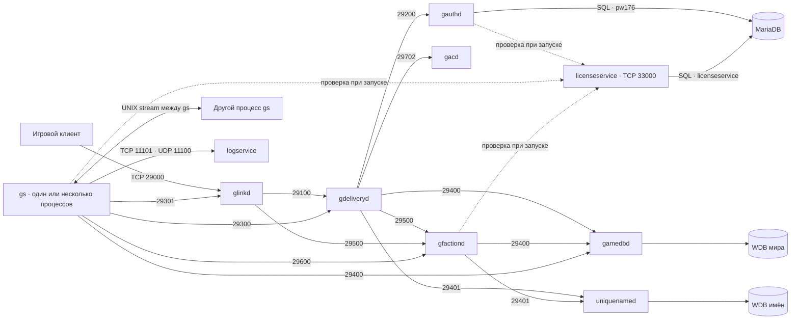

# Серверный комплект Perfect World 1.7.6

Сервер состоит из нескольких программ с собственными точками входа. `glinkd` принимает подключения, `gdeliveryd` координирует авторизацию и карты, `gs` выполняет игровую логику карты. Отдельные процессы владеют файловыми базами, гильдиями, журналом и другими функциями. Связи ниже получены от запущенного Build 4311. Имена и назначение операций сверены с доступными исходниками. [Контракты служб](runtime-contracts.ru.md)

## Что известно о происхождении

- В VM измерены размеры, CRC32 и SHA-256 десяти активных бинарников, `gamed/gs.conf` и `maps`. У всех 12 совпали размер и CRC32 с соответствующими элементами `Linear/PWServer176.7z`. Это связь двух исследованных комплектов. [Отпечатки VM](evidence/fingerprints.tsv) · [Сверка с архивом](evidence/archive-match.tsv)
- Два дерева, обозначенные `huzeming-176source` (`c0992a29`) и `code-bynary-176source` (`da5766ba`), содержат точки входа части служб и общие описания GNET. Их `build.sh` обращается к отсутствующим в этих копиях `cnet/gamedbd`, `cnet/gdeliveryd` и `cnet/glinkd`. Точная связь исходников с Build 4311, полный набор поставки разработчика и происхождение каждого файла остаются открытыми.
- Из более ранних и поздних деревьев можно сверять формы RPC и идею реализации. Версии `172source` (`1c425175`), `174source` (`0df9582c`) и 1.7.8 указаны там, где доказательство относится к ним. Для 4311 исходный код дополняют ELF, конфигурация, открытые файлы и наблюдаемые соединения.
- Лицензирование входит в исследованный игровой запуск. Каталог `cnet/licenseservice` в доступном дереве содержит неполную реализацию, а скрипт `installfunc` пропускает эту программу. Роль процесса `licenseservice` в Build 4311 подтверждают его конфиг, слушатель и подключения к MariaDB. Его происхождение остаётся отдельным вопросом.

## Точки входа и сборка

В двух деревьях 1.7.6 `build.sh all` подготавливает RPC, запускает сборку сетевых служб, игровых библиотек и движка, затем копирует результат в `/home`. В `cgame/gs/Makefile` есть цели `gs` и `solib` для `libtask.so`. Поставка сборочного скрипта упоминает `libtask.so` и `libskill.so`. В `DT_NEEDED` и `/proc/<PID>/maps` обоих запущенных `gs` зафиксированы системные библиотеки. Отдельные `libtask.so` и `libskill.so` в этих списках отсутствуют. Утилита `dbtool` собирается отдельной целью `share/common/Makefile.dbtool`. [Отчёт о `gs`](services/gs.ru.md) · [Файлы текущей раздачи](../rutracker-1.7.6-4311-architecture.ru.md#цели-сборки-в-доступных-исходниках)

Команды передают каждой программе её конфигурацию и выполняются из её рабочего каталога. У `gs` аргументы дополнительно задают карту и файлы `gs.conf`, `gmserver.conf`, `gsalias.conf`. Реализация 1.7.6 в `cgame/gs/start.cpp` разбирает алиасы и умеет создавать отдельные процессы для дополнительных алиасов. Код и конфиги дают несколько уровней идентификации карты, включая алиас, world tag и серверный идентификатор. [Карты и переходы](maps.ru.md)

## Обмен между игровыми службами

Сплошные линии к слушателям показывают наблюдавшиеся соединения, за исключением игровой точки входа `29000`, у которой в новом опыте проверялось прослушивание. Штриховые линии лицензии следуют из кода и файлов конфигурации. На схеме у `logservice` показан один пример отправителя. [Полная таблица](runtime-contracts.ru.md)

## Данные и жизненный цикл мира

У игровой учётки есть числовой ID и права в `pw176`. При создании персонажа `uniquenamed` резервирует имя и ID, а `gamedbd` хранит профиль с тем же набором идентификаторов. Игровое состояние состоит из бинарных записей WDB и журнала. Авторазмещение, сохранение персонажа и корректное завершение карты зависят от работы этого контура. [Связи двух WDB и SQL](storage-and-recovery.ru.md)

`gs` поднимает ресурсы карты, ожидает связи со службами и участвует в маршрутизации переходов. Протокол перехода использует сведения о world tag и доступном провайдере. Отдельные экземпляры внутри `gs` могут освобождаться по `idle_time`. Управление всем процессом карты требует собственного решения о готовности, допуске новых входов и завершении сохранения. [Исследование жизненного цикла карты](maps.ru.md)

Сценарии `/root/server`, `/root/start` и `/root/stop` описаны как часть RuTracker VM. Их порядок запуска подтверждает способ эксплуатации этой копии. В игровом комплекте применимы зависимости бинарников и их RPC. [Архитектура RuTracker VM](../rutracker-1.7.6-4311-architecture.ru.md#обслуживающие-скрипты-и-службы)
