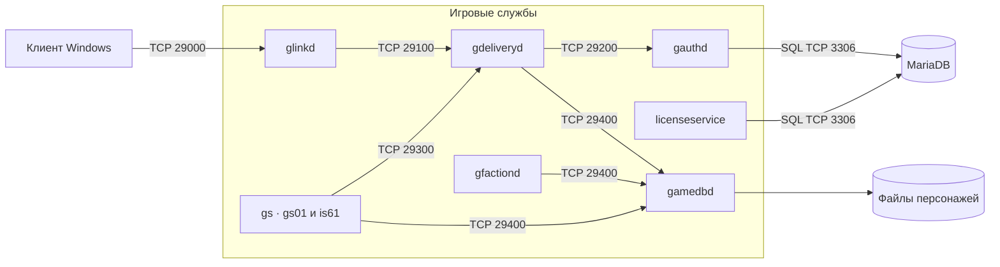
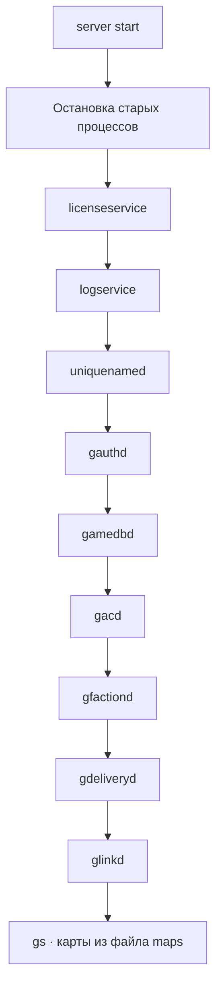
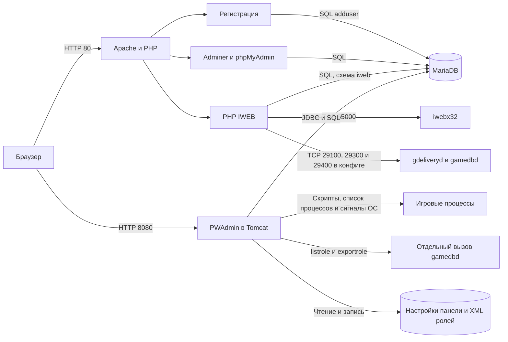

# Раздача RuTracker 1.7.6 Build 4311 — архитектура

Карта основана на файлах, настройках и запущенных процессах рабочей VM. Название «оригинальные компоненты PW» относится к игровым службам и их комплекту в `/root/pwserver`. Происхождение бинарников и их соответствие доступным исходникам отдельно не подтверждены.

## Оригинальные компоненты PW

Пути в этой главе указаны относительно `/root/pwserver`.

### Исполняемые службы

| Исполняемый файл | Назначение |
|---|---|
| `licenseservice/licenseservice` | Служба лицензирования. Слушает `127.0.0.1:33000` и подключается к MariaDB. |
| `logservice/logservice` | Принимает и записывает сообщения игровых служб. |
| `uniquenamed/uniquenamed` | Ведёт уникальные имена и идентификаторы персонажей и связанных сущностей. |
| `gauthd/gauthd` | Проверяет данные входа и запрашивает игровые GM-права. |
| `gamedbd/gamedbd` | Ведёт игровую файловую базу, включая состояние персонажей. |
| `gacd/gacd` | Серверная служба античита. |
| `gfactiond/gfactiond` | Служба гильдий. |
| `gdeliveryd/gdeliveryd` | Координирует подключение игровых служб и карт. |
| `glinkd/glinkd` | Игровой шлюз для Windows-клиента. В этой VM принимает подключения на TCP `29000`. |
| `gamed/gs` | Движок карты. Штатный запуск этой VM поднимает два экземпляра с аргументами `gs01` и `is61`. Каждый получает `gs.conf`, `gmserver.conf` и `gsalias.conf`. |

### Библиотеки, утилиты и варианты бинарников

| Файлы | Назначение и состояние |
|---|---|
| `gamed/libskill.so`, `gamed/libtask.so` | 64-битные игровые библиотеки умений и заданий. Они есть в комплекте и в сценарии сборки. При проверке обе библиотеки отсутствовали в списке загруженных файлов двух запущенных `gs`. |
| `gamed/gs_v1`, `gamed/gs_v2`, `gamed/gs_v3` | Дополнительные ELF64-версии движка карты. В проверенном запуске используется `gamed/gs`. |
| `gamedbd/gamedbd1`, `gdeliveryd/gdeliveryd1`, `gfactiond/gfactiond1`, `glinkd/glinkd!!!`, `uniquenamed/uniquenamed1` | Дополнительные ELF64-бинарники рядом с соответствующими активными службами. |
| `gamedbd/base_util`, `gamedbd/dbtool`, `gamedbd/dbanlz` | 32-битные утилиты работы с игровыми БД. `base_util` и `dbtool` статически слинкованы. У `dbanlz` интерпретатор `/lib/ld-linux.so.2`. Эти утилиты присутствуют в комплекте за пределами штатной последовательности игровых процессов. |

### Конфигурация

| Файлы | Назначение |
|---|---|
| `{gacd,gamedbd,gauthd,gdeliveryd,gfactiond,glinkd,licenseservice,uniquenamed}/gamesys.conf` | Настройки отдельных служб. В них заданы сетевые соединения, а у файловых БД также каталоги хранения. |
| `logservice/logservice.conf`, `gacd/gacd.xml` | Конфиги журналирования и античит-службы. |
| `gamed/{gs.conf,gmserver.conf,gsalias.conf,ptemplate.conf,ranking.conf,settings.conf}` | Настройки движка карт, алиасы и дополнительные конфиги игрового процесса. В `gs.conf` заданы пути к данным и параметры карт. |
| `gamed/config/{globalcontroller.conf,rare_item.conf,rare_item2.conf,special_item.conf}` | Дополнительные конфиги глобального игрового поведения и предметов. В `gs.conf` указана ссылка на `rare_item.conf`. |
| `gamedbd/{base_util.conf,cashstat.conf}` | Конфиг утилиты `base_util` и конфиг статистики денежных операций. |

### Игровые ресурсы

| Группа | Файлы |
|---|---|
| Шаблоны и поведение | `gamed/config/elements.data`, `aipolicy.data`, `DynamicObjects.data`. Первые два файла указаны в `gs.conf` как входные данные движка. |
| Задания | `gamed/config/{tasks.data,dyn_tasks.data,task_npc.data}`. `gs.conf` указывает `tasks.data` и `dyn_tasks.data` в параметрах пакетов заданий. |
| Магазин и торги | `gamed/config/{gshop.data,gshop1.data,gshop2.data,gshop3.data,sysauctionlist.txt,webtradeid.txt}` и `gdeliveryd/{auctionid.txt,sysauctionlist.txt,webtradeid.txt}`. Четыре файла `gshop*.data` указаны в настройках магазина `gs.conf`. |
| Территории, цели, выпадение предметов | `gamed/config/{domain.data,domain2.data,domain2.sev,domain2_cross.data,world_targets.sev,world_targets.txt,extra_drops.sev}` и `gdeliveryd/{domain.data,domain.sev,domain2.data,domain2.sev,domain2_cross.sev}`. `gs.conf` указывает `world_targets.sev` и `extra_drops.sev`. |
| Коллизии и файлы карт | `gamed/config/wmgj.nmd` соответствует параметру `CollisionElement`. Наборы карт в `gamed/config/{a*,b*,m01,mtv,random*,world}/` содержат геометрию, навигацию, регионы и размещение NPC. Примеры имён внутри наборов — `map`, `movemap`, `airmap`, `watermap`, `region.sev`, `path.sev` и `npcgen.data`. `gs01` использует `world/`, `is61` — `a61/`. |
| Символы и фильтры | `gacd/{charfont.dat,charlib.dat,hzfont.dat}` и `{gamed/config,gdeliveryd,gfactiond}/filters`. Каждый `filters` лежит в своём каталоге службы или движка. |
| Lua-скрипты игры | `gamed/{script.lua,skill.lua,config/global_api.lua}` и `{gamedbd,gauthd,gdeliveryd,gfactiond}/script.lua`. `gs.conf` указывает `global_api.lua` через `LuaData`. |
| Другие данные в комплекте | `gamed/config/serverlist.sev`, `gamedbd/{serverlist.sev,gamedata,clsconfig,clsconfig-o,clsconfig_176_pure}`. Использование каждого варианта в запущенных процессах отдельно не проверялось. |

В этой VM `aipolicy.data` — ссылка на `aipolicy-176-(5124)-ru-pure.data`, а `tasks.data` — на `tasks-176-(21606)-v191-ru.data`. Имена `-orig` и `-pure` ниже приведены как имена файлов из раздачи.

| Поставленные варианты в `gamed/config/` | Файлы |
|---|---|
| Политики ИИ | `aipolicy-176-(5124)-{cn,en,ru}-pure.data`, `aipolicy-176-(5385)-cn-orig.data`, `aipolicy-176-(5385)-{en,ru}.data`. |
| Задания | `tasks-176-(21606)-v191-{br,ru}.data`, `tasks-176-(21630)-v191-cn-orig.data`. |
| Шаблоны | `elements-orig.data`, `elements-bug list 302.data`. |
| Содержимое каталога `мусор/` | `airmap`, `empty`, `gshop11.data`, `gshopsev.data`, `gshopsev1.data`, `gshopsev2.data`, `gshopsev4.data`, `movemap`, `npcgen.data`, `watermap`. |

### Состояние и диагностические файлы

| Путь | Что лежит в VM |
|---|---|
| `gamedbd/dbhome/dbdata/` и `gamedbd/dbhome/dblogs/` | Файловая БД персонажей и её журнал. В `dbdata/` найдено 58 файлов. Журналы транзакций имеют имена `log.*`. |
| `uniquenamed/dbhome/dbdata/` и `uniquenamed/dbhome/dblogs/` | Отдельные данные имён и журнал. Файлы данных — `config`, `logicuid`, `uidrole`, `unamearenateam`, `unamefaction`, `unamerole`. |
| `logs/*.log`, `logs/world2.{cash,chat,err,formatlog,log,trace}`, `logs/{statinfod,statinfoh,statinfom}` | Журналы служб, карт и файлы статистики. Однотипные журналы по датам и службам сгруппированы. |
| `gamed/skilllog.txt`, `{gamedbd,gauthd,gdeliveryd}/lualog.txt`, `licenseservice/licenseservice.log` | Отдельные журналы рядом с соответствующими процессами. |
| `gamedbd/{1.txt,1024.xml,listrole.txt,mergereport}` | Текстовые и XML-файлы, найденные при инвентаризации каталога БД. Их создание в ходе проверки не воспроизводилось. |
| `glinkd/dump/`, `gamed/foo`, `gamedbd/cupon` | Пустой каталог и два пустых файла при инвентаризации. |

Имена файлов в gamedbd/dbhome/dbdata

`arenaplayer`, `arenateam`, `auction`, `base`, `city`, `clsconfig`, `config`, `crslogicuid`, `equipment`, `factionfortress`, `factioninfo`, `factionname`, `factionrelation`, `force`, `foundryformulas`, `friendext`, `friends`, `globalcontrol`, `gtask`, `home`, `inventory`, `kingelection`, `luaother`, `luarole`, `luatag`, `luauser`, `mailbox`, `mappassword`, `messages`, `mndomainbonus`, `mndomaininfo`, `mnfactionapplyinfo`, `mnfactioninfo`, `newroleinfo`, `newtrashbox`, `order`, `playerprofile`, `playershop`, `recalluser`, `rolename`, `rolenamehis`, `sellpoint`, `serverdata`, `shoplog`, `solochallengerank`, `status`, `storehouse`, `syslog`, `task`, `translog`, `uniquedata`, `user`, `userfaction`, `userstore`, `waitdel`, `weborderitem`, `webtrade`, `webtradesold`.

Оба процесса, `gamedbd` и `uniquenamed`, держат открытыми файлы в своих `dbhome/dbdata` и `dbhome/dblogs`. Этим путям соответствует раздел `[storagewdb]` их конфигов. В тех же конфигах есть отдельный `[storage]` с `homedir=./dbhomewdb`. В обоих разделах также задан `backupdir=./backup`.

### Связи работающих игровых служб

Связи на диаграмме подтверждены сетевыми соединениями и открытыми файлами на VM. Игровой вход в мир ранее проверен при остановленном PWAdmin.

### Цели сборки в доступных исходниках

| Путь в исходниках | Что видно в сборочных файлах |
|---|---|
| `huzeming-176source/cgame/gs/Makefile` | Цель `all` ведёт к `gs`. Цель `solib` ведёт к `libtask.so`. Правило линковки `gs` в этой копии содержит `libtask.so`. Правило также копирует результат в `/home/gamed`. |
| `build.sh` в `huzeming-176source` и `code-bynary-176source` | Принимает `all`, `gs`, `deliver`, `deliveryd` и `install`. Ветка `all` включает подготовку RPC, сборку сетевых служб, библиотек и игрового движка, затем вызывает копирование в `/home`. Ветка `gs` вызывает `buildgslib` для сборки библиотек. В списке копирования есть `gs`, `libtask.so`, `libskill.so` и восемь сетевых служб. |
| `cnet/gauthd`, `cnet/gacd`, `cnet/gfaction`, `cnet/uniquenamed`, `cnet/logservice`, `cnet/licenseservice` | Одноимённые области серверного кода. Имя каталога `gfaction` в исходниках отличается от имени поставляемого процесса `gfactiond`. Каталог `licenseservice` есть, шаг копирования в `installfunc` для него не указан. |
| `share/common/Makefile.dbtool` | Отдельная цель `dbtool` из `dbtool.cpp`. |

В обоих скачанных деревьях `build.sh` обращается к каталогам `cnet/gamedbd`, `cnet/gdeliveryd` и `cnet/glinkd`, которых в этих копиях нет. Сборку по этим рецептам не запускали. Проверенные ревизии — `c0992a29` у `huzeming-176source` и `da5766ba` у `code-bynary-176source`.

## Обслуживающие скрипты и службы

### Скрипты VM

| Путь | Назначение |
|---|---|
| `/root/server` | Основной сценарий управления процессами. Ветка `start` поднимает службы из `/root/pwserver`, пишет вывод в `logs/` и загружает карты из `/root/pwserver/maps`. |
| `/root/start`, ссылка `/root/pwserver/start` | Отдельный сценарий запуска с явно указанными `gs01` и `is61`. Ссылка ведёт на `/root/start`. |
| `/root/stop` | Сценарий остановки процессов. В скрипте есть вызовы `pkill`. |
| `/root/start_licenseservice.sh`, `/root/pwserver/licenseservice/{start.sh,stop.sh}` | Отдельные скрипты запуска и остановки службы лицензирования. |
| `/root/pwserver/chmod.sh` | Выставляет права на файлы игрового дерева. |
| `/root/pwserver/gamedbd/{batch_anlz.sh,dc,dr,fix.sh}` | Обслуживание файловой БД. `batch_anlz.sh` вызывает `dbanlz`, `dc` содержит вызовы `exportrole`, `dr` — `importrole` и `exportclsconfig`. `fix.sh` работает с путями `dbhome/dbdata` и `dblogs` и упоминает `dbtool`. |

Порядок ниже взят из ветки `start` скрипта `/root/server`. Сценарий начинает с `/root/stop` и задаёт паузы между запусками.

### Системные службы и SQL

- VM работает на Debian 13 amd64 с glibc 2.41. Десять активных игровых бинарников — ELF64 x86-64. У бинарников, проверенных через `readelf`, максимальная найденная версия символов glibc — `GLIBC_2.34`. Запущенные службы загружают системные библиотеки, включая `libpcre.so.3`, `libmariadb.so.3` и `libcrypto.so.3`.
- MariaDB — отдельная системная служба. В VM она принимает SQL на `127.0.0.1:3306`. Подключения `gauthd` и `licenseservice` к этому порту наблюдались при работе.
- В MariaDB хранятся учётки `pw176.users` и права `pw176.auth`. В `cnet/gauthd/gmysqlclient.cpp` вход вызывает `acquireuserpasswd`, права GM читаются по пользователю и зоне. Это часть игрового контракта с БД. Файловые базы персонажей и имён принадлежат процессам из первой главы.
- Apache и PHP обслуживают форму регистрации, PHP IWEB и веб-интерфейсы к MariaDB. OpenSSH используется для обслуживания гостя. Эти компоненты поставляются как инфраструктура VM.

## Внешние панели и форма регистрации

`yourIP` в MOTD — адрес гостя. В проверенной сети VirtualBox host-only это `192.168.56.101`. Cockpit выведен в строке веб-консоли сразу после MOTD.

| Панель или форма | Адрес на скриншоте MOTD | Назначение и состояние проверки |
|---|---|---|
| Webmin | `https://yourIP:10000` | Администрирование Debian. Служба активна. В Edge открывается предупреждение о сертификате. |
| phpMyAdmin | `http://yourIP/phpmyadmin` | Веб-интерфейс MariaDB. Форма открылась, вход показал ошибку сессионного cookie по HTTP. |
| Adminer | `http://yourIP/adminer.php` | Веб-интерфейс MariaDB. Вход и просмотр структуры `pw176` подтверждены. |
| Форма регистрации | `http://yourIP` | Главная страница даёт ссылку на форму 1.7.6 в `/registration/registration176/index.php`. Страница формы вернула HTTP 200. Код регистрации использует `adduser`. |
| PWAdmin | `http://yourIP:8080` | Управление игровыми учётками, персонажами, процессами и картами. Обновлённая панель открывается в `/pwadmin176new/`. Вход, статус служб и просмотр настроек резервного копирования подтверждены. |
| PHP IWEB | `http://yourIP/iweb` | Управление игровыми учётками, персонажами и сервером. Вход и список процессов проверены после настройки IP и запуска `iwebx32`. |
| Cockpit | `https://debianpw176:9090/` | Веб-консоль Debian. Сокет активен. В Edge открывается предупреждение о сертификате. |

### Каналы доступа к игре и данным

- **Регистрация, Adminer и phpMyAdmin.** Apache обслуживает главную страницу `/var/www/html/index.html` и форму `/var/www/html/registration/registration176/`. `adminer.php` ведёт на `adminer-5.3.0-mysql.php`. `phpmyadmin` ведёт в `/usr/share/phpmyadmin`. Эти интерфейсы работают через SQL. Игровые службы подключаются к MariaDB самостоятельно.
- **PHP IWEB.** Веб-файлы лежат в `/var/www/html/iweb`. Адреса и порты заданы в `system/data/config.php`. Веб-вход проверяется в `iweb.users`. `/root/phpiweb/iwebx32` — отдельный статически слинкованный ELF32 i386 с портом `65000`. При его остановке после входа наблюдалась ошибка сокета. После запуска открылись статус и список игровых процессов. В конфигурации панели также есть порты `29100`, `29300` и `29400` для игровых служб.
- **PWAdmin.** Рекомендованный архив развёрнут в `/root/pwadmin`. Tomcat запускается на 64-битной Java 7 из архива. Создание первого веб-администратора добавляет запись в `pw176.admin_users`. Права доступа к экранам панели хранятся в `pw176.gmpanel_users`. Через JDBC панель также вызывает игровые процедуры `adduser` и `addGM`. При входе IP проверяется по `WEB-INF/whitelist.txt` после сверки пароля. Настройки панели хранятся в `.pwadminconf.properties`.
- **Управление процессами из PWAdmin.** В `serverctrl.jsp` есть запуск локальных скриптов `server`, `iweb_map.sh` и `pw_backup.sh`, чтение списка процессов через `ps` и сигналы через `kill` и `pkill`. Для списка и экспорта персонажей JSP запускает отдельный `gamedbd` с `gamesys.conf` и работает с XML. Прямой доступ к памяти игрового процесса в просмотренном коде не обнаружен. В браузере проверен просмотр статуса и настроек резервного копирования.
