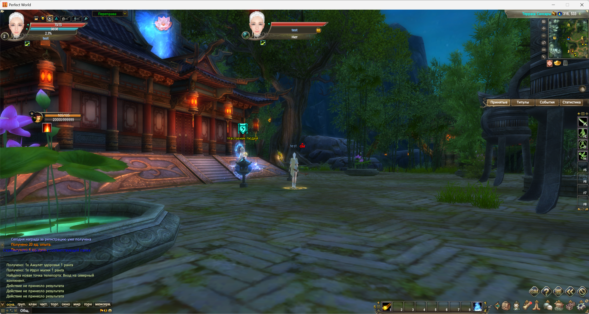
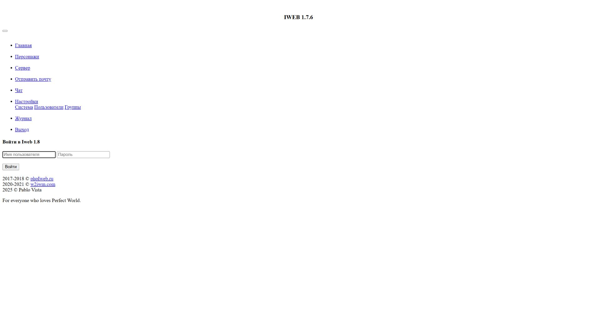
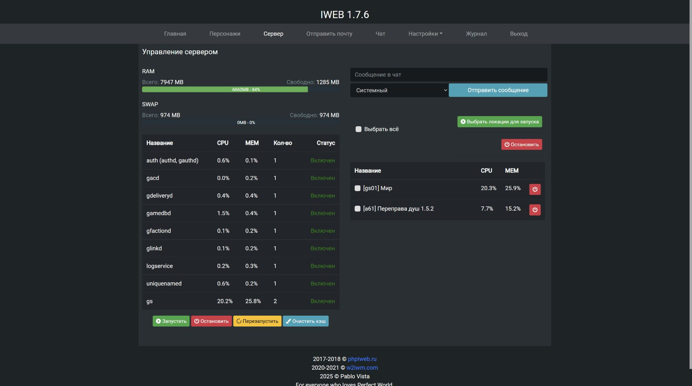
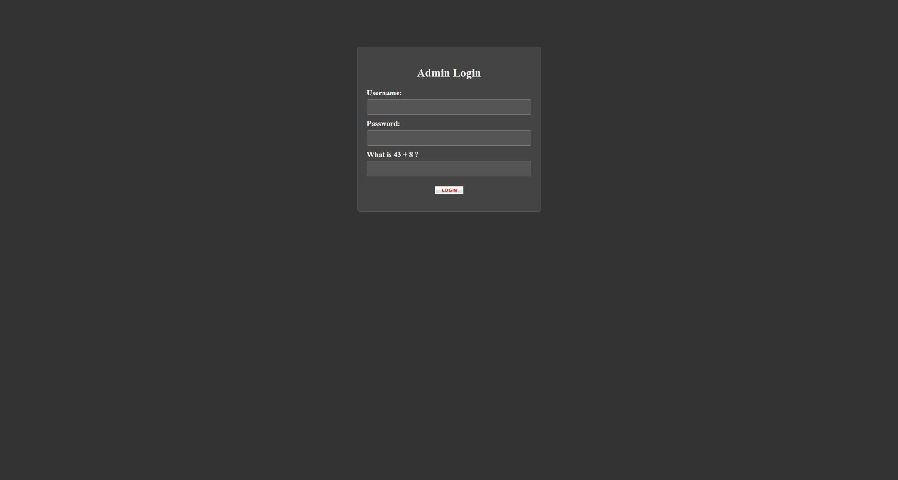
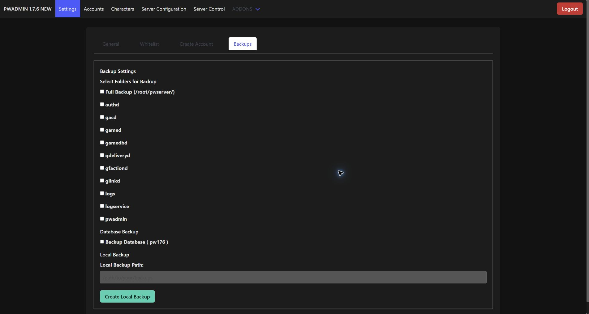
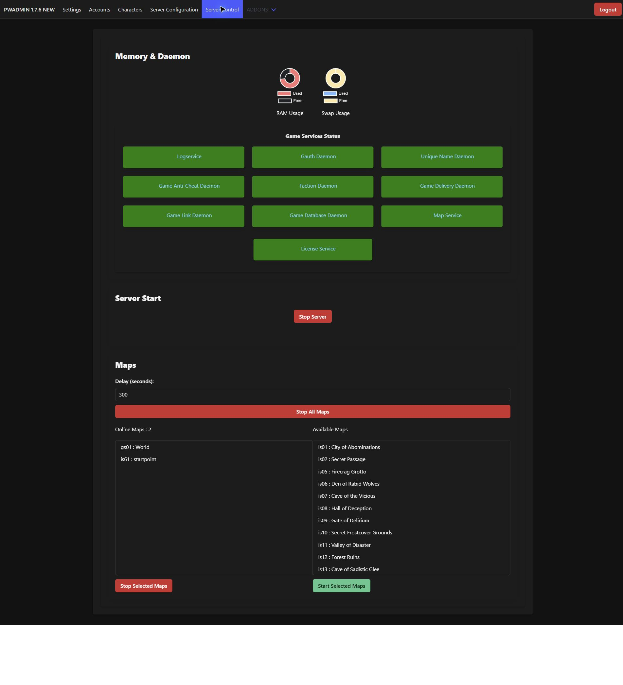
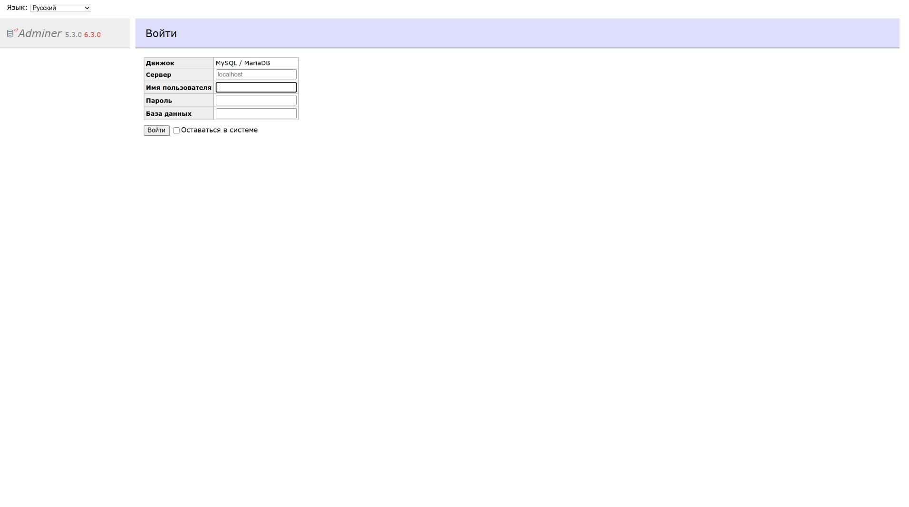
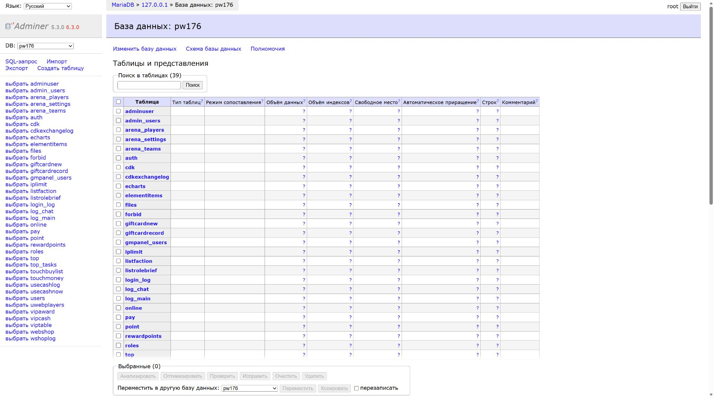
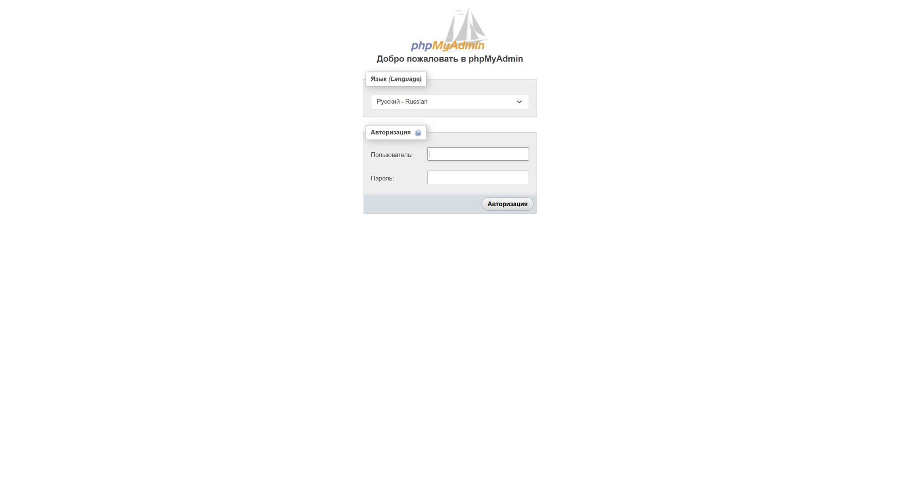
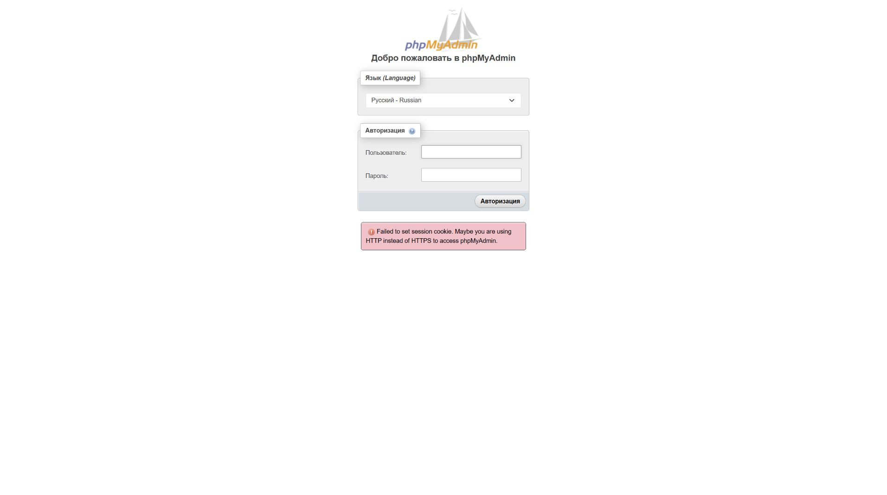

# Раздача RuTracker 1.7.6 Build 4311 — запуск и использование

Проверка проведена на локальной VM Debian и 64-битном Windows-клиенте из раздачи. Клиент подключался через сеть VirtualBox host-only по адресу `192.168.56.101`.

## Первый запуск

1. Распаковать `PWSERVER-1.7.6.7z` и `PerfectWorld-176.7z` в рабочую директорию. Добавить в VirtualBox файл `PWSERVER-1.7.6.vbox` из серверного архива. Его диск называется `PWSERVER-1.7.6-Debian-13-052025.vmdk`.
2. Установить Microsoft DirectX End-User Runtimes (June 2010) на Windows, если при запуске клиент сообщает об отсутствии `d3dx9_43.dll`. Офлайн-пакет есть в `winetricks_cache/directx9` распакованного клиента. Установка выполняется через `DXSETUP.exe` после распаковки пакета.
3. Подключить сетевой адаптер VM к сети VirtualBox host-only, запустить VM и проверить её IPv4 через `ip -br -4 address`. В клиенте заменить IP в `game_info/data/patcher/server/serverlist.txt`. Кодировка файла UTF-16 LE с BOM. В строке `ServerPW` порт записан перед IP, поля разделены табуляцией.
4. Войти на тестовую VM по SSH как `root` с паролем `123456`, как указано в инструкции автора. Выполнить `server start` и дождаться загрузки карт. В проверенной VM выделено 2 vCPU и 8 ГиБ RAM. В штатной конфигурации включены `gs01` и `is61`. Игровой шлюз слушает TCP `29000`.
5. Подготовить игровую учётку. В MOTD указан логин `1234` с паролем `1234`. В проверенной копии `pw176.users` была пустой, поэтому тестовую запись создали штатной процедурой `adduser`. На странице раздачи и в VM есть ссылки на форму регистрации.
6. На Windows запустить `game_info/data/start64.bat`, выбрать `ServerPW`, войти, создать персонажа и загрузить мир.

На экране персонажей наблюдались битая кодировка тела блока «Новости», отсутствие фоновой музыки при создании персонажа и отсутствие звуков анимаций у части классов. В клиентском логе есть отдельная ошибка чтения WAV-файла интерфейса. Причины проверяются.

## Веб-панели

| Панель | Назначение и доступ | Что получилось |
|---|---|---|
| PHP IWEB | Управление персонажами, аккаунтами и игровыми службами. Веб-адрес `http://192.168.56.101/iweb/`. Использует свою веб-учётку. | Вход подтверждён после обновления IP и запуска `iwebx32`. Раздел «Сервер» показал статус служб и две игровые карты. |
| PWAdmin | Управление аккаунтами, ролями и процессами игры. Адрес обновлённой панели `http://192.168.56.101:8080/pwadmin176new/`. Использует свою веб-учётку. | Вход прошёл после добавления Windows-хоста в белый список. `Server Control` показал запущенные службы и карты `gs01` и `is61`. |
| Adminer | Просмотр и управление MariaDB через браузер. Веб-адрес `http://192.168.56.101/adminer.php`. В форме указывается адрес MariaDB с точки зрения VM, в проверке `127.0.0.1`. | Вход с учёткой MariaDB и просмотр структуры `pw176` подтверждены. |
| phpMyAdmin | Другой веб-интерфейс к MariaDB. В сохранённой теме указан `http://IP_Сервера/phpmyadmin/`. | Форма открывается. После отправки по HTTP показано предупреждение о расхождении HTTP и HTTPS и ошибке сессионного cookie. В сохранённой теме нет инструкции по очистке cookie. |
| Регистрация | Форма создания игровой учётки. Адрес из MOTD `http://192.168.56.101/`. | В игровом тесте учётку создали через `adduser`. Регистрация через браузер отдельно не проверялась. |
| Webmin и Cockpit | Администрирование Debian через HTTPS. На VM слушают TCP `10000` и `9090`. | В Edge доступ упёрся в предупреждение о сертификате. Вход через браузер не проверен. |

Указанные рядом с формами реквизиты относятся к локальной тестовой VM. У тестовой игровой учётки есть серверные GM-права, что видно в игре и подтверждено записями в `auth`.

### Форма IWEB

После смены IP гостя указать адрес веб-интерфейса в `$site_adr` и IP гостя в `$server_hostname` в `/var/www/html/iweb/system/data/config.php`. В исходном образе оба параметра ссылались на прежний адрес. Если служба на TCP `65000` ещё не запущена, выполнить на VM `cd /root/phpiweb && ./iwebx32 start`. Затем войти в веб-интерфейс и открыть «Сервер».

Вход в IWEB на тестовой VM — логин `root`, пароль `123456`.

В команде второго процесса `gs` указан идентификатор `is61`. IWEB подписывает эту карту `[a61] Переправа душ 1.5.2`.

### Обновлённый PWAdmin

1. Передать `pwadmin.7z` из сохранённого комментария автора по SCP и сверить SHA-256 на хосте и госте.
2. Распаковать архив в отдельный каталог. Сохранить прежний `/root/pwadmin` и поставить на его место распакованный каталог `pwadmin`. Для проверенного запуска используется Java из архива.
3. Запустить на VM `JAVA_HOME=/root/pwadmin/jre7 /root/pwadmin/bin/startup.sh`. Tomcat обслуживает TCP `8080`.
4. Открыть `/pwadmin176new/`. Для входа нужны веб-учётка PWAdmin и ответ на проверочный вопрос. По коду панели при пустой `admin_users` показывается форма создания первого веб-администратора. В проверенной VM открылась обычная форма входа.

Вход в PWAdmin на тестовой VM — логин `root`, пароль `123456`. Оба значения сверены с записью администратора PWAdmin.

При сообщении `IP is not whitelisted` добавить адрес клиента отдельной строкой в `/root/pwadmin/webapps/pwadmin176new/WEB-INF/whitelist.txt`. В проверенной сети VirtualBox host-only адрес клиента Windows — `192.168.56.1`. PWAdmin перечитывает список при следующей попытке входа.

После входа `Settings → Backups` показывает варианты резервного копирования каталогов игры и базы `pw176`. `Server Control` показывает статус процессов и карты.

### Вход в Adminer и структура базы

В Adminer выбрать MySQL и указать сервер MariaDB `127.0.0.1`, логин `root`, пароль `123456`.

### Форма и ответ phpMyAdmin

Для MariaDB используется та же тестовая учётка `root` с паролем `123456`. Веб-вход остановился на ошибке сессионного cookie.

