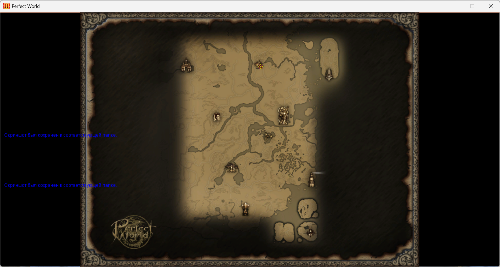

# Сеть телепортации у мастера

Контрольный маршрут — Чэнь Яо в Городе Мечей (`2101`) → Тайная деревня (`2103`, мастер Ду Гуйчэн). В конфигурации раздачи обе точки обслуживает `gs01`. Цена — 200 монет, минимальный уровень — 1. Начальное состояние `tptest` сверяем по `waypointlist`, открытие источника подтверждаем разговором с Чэнь Яо.

## Прогоны

1. У Чэнь Яо открыть «Службу телепортации» с закрытой Тайной деревней. Зафиксировать доступность пункта и баланс.
2. Дойти до Ду Гуйчэна обычным перемещением, поговорить с ним и зафиксировать открытие `2103`. Вернуться к Чэнь Яо в той же сессии. Дорога подходит и для [контроля ходьбы](../world-movement/plan.ru.md).
3. Открыть сеть, выбрать Тайную деревню один раз и сверить координаты прибытия, баланс и непрерывность сессии. Успех — пункт стал доступен, персонаж оказался у цели, баланс уменьшился ровно на 200.
4. Если пункт остался недоступен, сверить подтверждение открытия точки и её отображение клиентом. Если запрос доходит до сервера, проверить выбранный маршрут, состояние роли, цену и достижимость назначения.

## Карта с закрытой Тайной деревней

17 ноября `tptest` открыл «Службу телепортации» у Чэнь Яо. На карте видна одна отметка у Города Мечей. В сохранённом `waypointlist` открыт исходный пункт `2101`, Тайная деревня (`2103`) закрыта.

## Переход при запущенных участках

Для прогона после выхода из аккаунта сохранили роль `1027`, открыли ей `2103` в `waypointlist` и установили исходный баланс 1000. Повторный экспорт подтвердил изменения. Мир с тегом `1` разделили на два участка в копии конфигурации. `gs01` обслуживал Город Мечей, `gs02__` — Тайную деревню.

На карте появился пункт Тайная деревня. Клиент предложил потратить 200 золота при нулевом серебре. После подтверждения персонаж сразу оказался в Тайной деревне (`497, 870, 22`), затемнения игрок не увидел. В `world2.trace` за 16:02:14 есть `SwitchServerStart` и успешный перенос роли `1027` с GS `1` на GS `2`.

[Выбор точки и цена](evidence/chen-waypoint-2103-open.png) · [Прибытие в Тайную деревню](evidence/warm-arrival-secret-village.png)

### Провал под землю после прибытия

Рюкзак показал 800 золота и 0 серебра, что подтверждает списание 200 золота. По наблюдению игрока, после прибытия персонаж подпрыгнул и провалился под поверхность. При неизменных координатах `497, 870` высота на мини-карте упала с `22` до `0`. Сервер затем синхронизировал позицию `(973.885986, 0, 3201.252930)` и зарегистрировал движение ниже земли. Проверку причины см. в разделе о холодном переходе.

[Баланс после переноса](evidence/warm-arrival-800-gold.png) · [Персонаж под землёй](evidence/warm-arrival-below-terrain.png)

## Холодный переход с затемнением

После провала вернули роль к Чэнь Яо в точку `(482.76181, 258.864075, 3248.15845)`. Экспорт подтвердил позицию, 800 золота и открытую Тайную деревню. Перед входом остановили целевой `gs02__` с PID `18261`.

| Время на ВМ | Событие |
| --- | --- |
| `16:08:24.382` | Скрипт удержал исходный запрос службы после подтверждения 200 золота. |
| `16:08:28` | Lua на `gs01` включил клиентское затемнение. |
| `16:08:39.384` | После заданных 15 секунд запущен `gs02__` с новым PID `18958`. |
| `16:08:43.047` | Новый процесс зарегистрировался в `gdeliveryd`. |
| `16:08:45.883` | Маршрут готов. Скрипт передал тот же запрос серверу через 21,50 с после получения. |
| `16:08:45` | Lua снял затемнение, штатная служба списала 200 золота, `world2.trace` подтвердил переход GS `1 → 2`. Остаток 600. |

Игрок подтвердил затемнение до перехода. Персонаж появился в Тайной деревне с высотой `22`, стоял около 10 секунд и при первом движении ушёл под землю. Сервер записал синхронизацию высоты `0`. Точку прибытия `(973.885986, 225.056000, 3201.252930)` взяла штатная служба из маршрута `2103`.

[У Чэнь Яо](evidence/cold-01-at-chen.png) · [Начало затемнения](evidence/cold-02-fade-start.png) · [Чёрный экран](evidence/cold-03-blackout.png) · [Прибытие](evidence/cold-04-arrival.png) · [После движения](evidence/cold-05-below-terrain.png)

При подготовке `World_gs02__` перенесли флаг `height-limit` и пропустили `height_limit=800.0` из штатного `World_gs01`. В исходнике H176 пустое значение преобразуется в `0`, а превышение лимита сбрасывает высоту роли до `0`. Для повтора вернули штатный параметр и использовали ту же точку входа. [Чтение параметра](https://github.com/huzeming/176source/blob/c0992a29/cgame/gs/worldmanager.cpp#L383-L389) · [Проверка высоты](https://github.com/huzeming/176source/blob/c0992a29/cgame/gs/player.cpp#L6275-L6281)

## Повтор со штатным пределом высоты

В рабочей копии `World_gs02__` добавили `height_limit=800.0`. Экспорт подтвердил подготовку `tptest` у Чэнь Яо с теми же координатами и остатком 600 золота. Целевой процесс `18958` остановили перед входом.

В `16:16:24.826` скрипт удержал запрос. Lua включил затемнение в `16:16:31`. После 15 секунд искусственной задержки стартовал `gs02__` с PID `19609`. Регистрация заняла около 4,2 секунды после запуска. Скрипт дождался появления маршрута и передал запрос через 37,14 секунды после получения. Затемнение держалось около 30 секунд по отметкам Lua. В `16:17:02` сервер подтвердил перенос GS `1 → 2` и баланс 400 золота.

Перед переносом игрок увидел один кадр Города Мечей. Lua снимает экранный эффект перед выполнением штатного переноса, поэтому между событиями может отрисоваться исходная локация. Полоса загрузки в этом переходе внутри `worldtag=1` не появлялась.

После прибытия игрок переместился кликом по земле и затем клавишами. Персонаж остался на поверхности, на снимке после движения мышью высота `22`. [Тайная деревня после движения](evidence/cold-repeat-after-mouse-move.png)

## Воспроизведение на стенде 4311

Для выбора конфигов и проверок готовности использовать [сравнение способов запуска карт](../../../research/maps.ru.md#запуск-из-панелей-раздачи).

Использовать `tptest` (роль `1027`, уровень 20) в Городе Мечей на `(482.76181, 258.864075, 3248.15845)`. Открытые пункты для маршрута — `2101` и `2103`. Для контрольных оплат достаточно 1000 золота и 0 серебра. Архивировать исходную роль перед подготовкой.

Подготовить `source/` и `target/` в одном каталоге прогона. В обоих каталогах использовать штатный `gs`, `config/world/` и копии конфигурации. Добавить `gs02__` в `world_servers` в `gs.conf` и `gsalias.conf`. Для обоих участков оставить `tag=1`, сетку и параметры рельефа штатного мира. В обеих секциях мира включить `height-limit` с `height_limit=800.0`.

| Алиас | `index` | `base_region` по X | `local_region` по X | TCP | UNIX |
| --- | --- | --- | --- | --- | --- |
| `gs01` | `1` | `−4096…725` | `−4096…740` | `10901` | `/tmp/gssock_world1` |
| `gs02__` | `2` | `725…4096` | `710…4096` | `10902` | `/tmp/gssock_world2` |

Диапазон Z обоих участков `−5632…5632`. `source/gmserver.conf` в секции `[GProviderClient2]` подключается к `127.0.0.1:29311`. Скрипт принимает соединение на этом порту и передаёт штатный поток между `gs01` и `glinkd` на `127.0.0.1:29301`. Целевой `gs02__` подключается к штатному порту напрямую.

1. В каталоге прогона разместить [сетевой скрипт](network-relay.py), [описание роли и мира](route.lua) и файл `map_autoload.py`. Последний скопировать из [скрипта ленивой загрузки при входе](../map-login-autoload/map-autoload.py). В `delay-seconds` записать `15`.
2. Добавить [Lua-обработчик](network-screen.lua) в конец `source/script.lua`. Запустить `python3 -B network-relay.py` с выводом в `relay.log`. Запустить исходный `gs01` из `source/` с `PW_TELEPORT_PROBE_DIR`, указывающим на каталог прогона, и выводом в `source.log`. Запустить целевой `gs02__` из `target/`. Обоим процессам передать `gs.conf gmserver.conf gsalias.conf` после алиаса.
3. С обоими работающими участками подтвердить штатный выбор Тайной деревни у Чэнь Яо. Проверить в `relay.log` строку `Teleport network route 2103 command 37 observed`. Вернуть роль на исходный участок и убедиться, что целевой участок свободен.
4. Остановить целевой процесс и записать `37` в `arm`. Следующее подтверждение Тайной деревни удерживается до готовности цели. Сверить новый PID, регистрацию GS `2`, `Add dispatcher 2` у источника, снятие затемнения, успешный `SwitchServer` и одно списание 200 золота.

## Маршрут между разными мирами

Следующий кандидат — Жаклин в Неоле на `is78_part2` (тег `192`) → Рунград на `is78` (тег `178`). Сначала при двух работающих картах подтвердить, что пункт виден и штатный запрос действительно переводит сессию между процессами. Холодный прогон имеет смысл после этого контроля. Для него проверить ожидание готовности до списания платы и начала штатного переноса.
