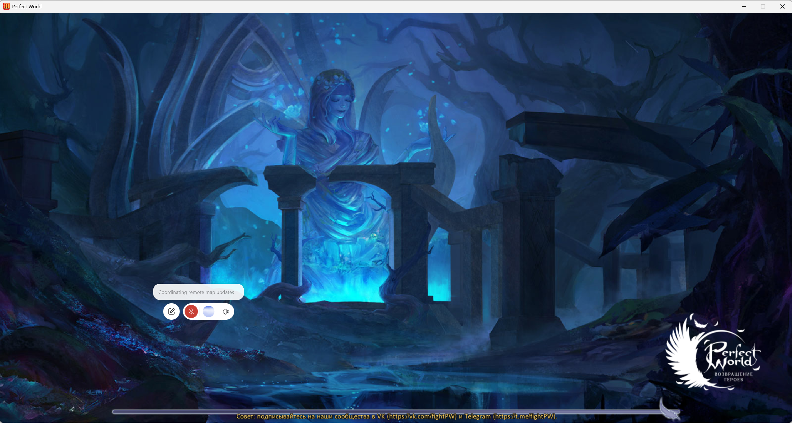
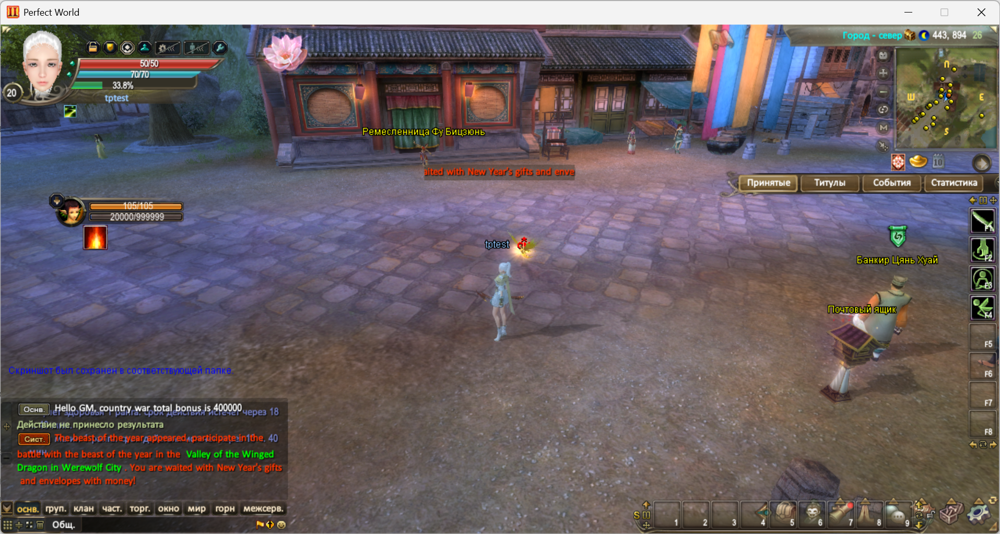

# Проблемы и ресурсы клиента Perfect World 1.7.6 Build 4311

Наблюдения относятся к русскому Windows-клиенту 4311 из комплекта RuTracker, использованному на стенде. Контрольная копия для сравнения — RU-клиент из Linear до наложения RU-патча.

## Что проверить перед сборкой клиента

### Сторонние ссылки в подсказках

В `element/interfaces.pck → interfaces/tips.txt` загрузочного экрана есть ссылки на сообщества FightPW в Telegram и VK. Этот `interfaces.pck` совпал по SHA-256 у RuTracker и патча из Linear. В контрольном RU-клиенте подсказка содержит ссылку на официальное сообщество PW. При подготовке сборки убрать ссылки FightPW из `tips.txt`, проверить остальные упакованные ссылки и затем просмотреть подсказки в запущенном клиенте. [Сверка ресурсов](../experiments/maps/map-login-autoload/map-autoload-experiment.ru.md#клиентские-ресурсы-перед-финальной-сборкой)

### Окно закрывается, процесс остаётся в трее

Обработчик `WM_CLOSE` в `elementclient_64.exe` 4311 скрывает окно и регистрирует значок в области уведомлений. Проверенный процесс продолжал отвечать Windows и держал около 2,8 ГиБ памяти при закрытом игровом соединении. Повторные запуски после закрытия крестиком могут оставлять несколько активных экземпляров. [Значок после закрытия окна](evidence/client-after-close-tray-icon.png)

При нажатии на значок в трее пользователь меню не увидел. По коду левый клик должен показать окно. В ресурсах интерфейса есть отдельная кнопка «Выйти из игры» с командой `quitgame`. Проверить в живом клиенте восстановление того же окна по значку и завершение того же процесса через `quitgame`. Критерий завершения — исчезновение PID `elementclient_64.exe`.

### HighRes и создание персонажа

В `element/userdata/systemsettings.ini` режим улучшенных моделей задаёт параметр `[Video] HighPoly`. При `HighPoly = 1` кнопка «Создать персонажа» оставалась серой. В журнале было восемь ошибок `CECPlayer::LoadPlayerModel,high poly model should not use this function`. После полного перезапуска с `HighPoly = 0` кнопка стала активной, и сервер подтвердил создание мага. На уже существующем персонаже изменились причёска и одежда. [Протокол проверки HighPoly](../experiments/maps/map-login-autoload/map-autoload-experiment.ru.md#неактивная-кнопка-создать-персонажа)

При повторном запуске 17 ноября в файле настроек рабочего клиента стояло `[Video] HighPoly = 1`. Пользователь видел HighRes-модели и текстуры. Первое наблюдение активной кнопки после входа с логином и паролем он позже оценил как возможную ошибку. После выхода из игрового мира кнопка «Создать персонажа» на экране выбора была серой. После повторного входа в аккаунт кнопка также была серой. [Снимок после выхода из мира](evidence/client-highpoly-role-selection.png) · [Снимок после входа в аккаунт](evidence/client-highpoly-account-login.png)

Повторить создание и сравнить отображение одной и той же роли на контрольном RU-клиенте с `HighPoly = 1` и `HighPoly = 0`. Если сбой проявится только в клиенте с патчем, сверить ресурсы моделей и редактора персонажей. Исправление проверить с включёнными улучшенными моделями.

### DirectX при запуске на Windows

У `element/elementclient.exe` и `element/x64/elementclient_64.exe` 4311 в таблице импортов есть `d3d9.dll` и `d3dx9_43.dll`. Если Windows сообщает об отсутствии `d3dx9_43.dll`, установить Microsoft DirectX End-User Runtimes (June 2010). В распакованном клиенте есть офлайн-пакет `winetricks_cache/directx9/directx_Jun2010_redist.exe`. После распаковки установка запускается через `DXSETUP.exe`. Проверить запуск обоих исполняемых файлов на чистой Windows и записать фактическое сообщение об ошибке, если она повторится. [Инструкция по запуску](rutracker-1.7.6-4311-usage.ru.md#первый-запуск)

### Автоматические объявления о событиях

На локальном стенде в системном чате и бегущей строке появляется английский анонс новогоднего события «The beast of the year appeared…» без действий игрока. Эту строку и «New Server Event starts» нашли в серверном aipolicy.data. SHA-256 исследованного файла совпал с ресурсом, который использует рабочий gs. Такому объявлению достаточно локального сервера и его игровых правил. Точное условие запуска события пока не установлено.

Для офлайн-профиля проверить отключение ненужных массовых анонсов, а для оставленных событий сверить русский текст.

### Новости, звук и телепортация

- На экране выбора персонажа текст «Новостей» отображался с битой кодировкой. В редакторе персонажа отсутствовала фоновая музыка, у части классов не звучали анимации. В журнале отдельно была ошибка чтения WAV-файла интерфейса. Сравнить каждый симптом с контрольным RU-клиентом. [Наблюдения первого запуска](rutracker-1.7.6-4311-usage.ru.md#первый-запуск)
- Карта сети телепортации у Чэнь Яо показала Тайную деревню после открытия `2103` в `waypointlist`. Штатный переход списал 200 золота. У Лу Фэя ранее наблюдалась карта без доступных для выбора точек. [Проверка сети телепортации](../experiments/maps/teleport-network/plan.ru.md) В холодном прогоне сообщение о выполнении задания появилось раньше переноса, который занял около 22 секунд. При проверке интерфейса отдельно смотреть, что видит игрок в этот промежуток. [Протокол телепорта](../experiments/maps/cold-teleport/map-teleport-experiment.ru.md)

## Какие файлы синхронизировать

Для согласованной пары 4311 выбрать один вариант игровых данных и сверить SHA-256 клиентских файлов с файлами, которые сервер действительно открывает в `gamed/config/`. Для шаблонов и заданий проверить значения `itemDataFile`, `QuestPackage` и `QuestPackage2` в секции `[Template]` файла `gamed/gs.conf`. При наличии симлинка сверять его цель.

| Клиент | Сервер относительно `gamed/config/` | Проверка |
|---|---|---|
| `element/data/elements.data` | `elements.data` | Совместимые шаблоны и идентификаторы. SHA-256 RuTracker и RU-патча совпал с активным серверным файлом. |
| `element/data/tasks.data` | `tasks.data` | Пакет формата 191. В согласованной паре 21 606 верхнеуровневых записей. У клиента Linear до патча их 21 624. |
| `element/data/gshop.data`, `gshop1.data`, `gshop2.data`, `gshop3.data` | Одноимённые файлы | Сверить все четыре таблицы магазина. Подтверждено совпадение SHA-256 RuTracker, RU-патча и активного сервера. |
| `element/userdata/dyn_tasks.data` | `dyn_tasks.data` | Проверить отдельно от семи файлов RU-патча. В RuTracker совпал с сервером по SHA-256. В согласованной копии 77 записей, в клиенте Linear 198. |
| `element/data/task_npc.data` | `task_npc.data` | Сверить формат, список NPC и метку `time_mark`. В проверенных копиях содержимое и счётчик 1 572 совпали, различались четыре байта метки заголовка. |

Если основой служит клиент Linear, наложить на рабочую копию `elements.data`, `tasks.data`, четыре файла `gshop*.data` и `element/interfaces.pck` из RU-патча. Пакет интерфейсов содержит подсказки и требует описанной выше чистки. Динамические задания сверить отдельно. В комплекте RuTracker все семь файлов патча и `dyn_tasks.data` уже совпадают с проверенными ресурсами. У обоих клиентов одинаковые исполняемые файлы 4311, поэтому сборку данных проверять по отпечаткам самих файлов. [Серверные пути и контрольные суммы](server-patching.ru.md#что-меняется-в-build-4311)

Клиентские `domain.data`, `domain2.data` и `domain2_cross.data` брать из выбранного клиентского комплекта. Серверные ресурсы территорий `.sev` читает `gdeliveryd`. `aipolicy.data` читает игровой сервер как ресурс поведения NPC. Адрес подключения и настройки графики задаются в клиентских `patcher/server/serverlist.txt`, `element/userdata/currentserver.ini` и `element/userdata/systemsettings.ini` для конкретного стенда. [Серверные варианты ресурсов](server-locales.ru.md)

## Имеющиеся комплекты

Пути к архивам приведены относительно локального каталога `Perfect World Server`.

| Комплект | Файлы и назначение |
|---|---|
| Linear, 1.7.6 Build 4311 RU | `Linear/Perfect World Client 1.7.6 Build 4311 (RU).7z` — контрольный клиент. `Linear/PWServer176.7z` — серверное дерево. `Linear/Patch-client-1.7.6-ru.7z` — семь клиентских файлов для этой пары. |
| RuTracker, 1.7.6 Build 4311 | В `RuTracker/Perfect World v1.7.6 Build 4311/` лежат `PerfectWorld-176.7z` с уже наложенными RU-ресурсами и `PWSERVER-1.7.6.7z` с VM. |
| Рабочий стенд 4311 | Распакованный клиент `PW-Example/PerfectWorld-176/game_info/data/` и VM `PW-Example/PWSERVER-1.7.6/`. Использовались в опытах с входом и телепортом. |
| RageZone, talolan 1.7.6 | `RageZone/talolan 1.7.6.zip` содержит другой образ VM, варианты `gs` и одноимённый RU-патч с другим содержимым. При выборе патча учитывать происхождение и SHA-256. |
| 1.5.5 V156 | У Linear есть `PWServer155.7z` и `Patch-client-1.5.5-ru.7z`. У RuTracker есть пара `PWServer.7z` и `PerfectWorld.7z` в каталоге `Perfect World 1.5.5 V156`. |
| Варианты для сравнения серверов | `RageZone/174.rar` содержит комплект 1.7.4 v352. `RageZone/PW1.7.6Playerbots.rar` содержит мод на базе неполной ветки 1.7.8. |

[Происхождение серверных комплектов 4311](distribution-provenance.ru.md) · [Инструкция по рабочему комплекту](rutracker-1.7.6-4311-usage.ru.md)
