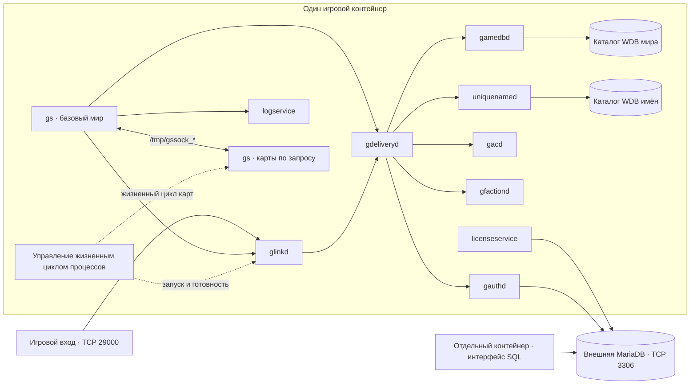

# Один игровой контейнер

Контейнерный вариант устанавливает те же DEB-пакеты, что и хостовая сборка, и применяет контейнерные overrides. Один игровой контейнер выполняет десять игровых программ, в том числе `gamedbd`, `uniquenamed` и нужное число экземпляров `gs`. Отдельный сервис MariaDB обслуживает обе SQL-схемы. Панели запускаются в собственных контейнерах. Мир и имена используют отдельные каталоги состояния WDB. Службы используют симлинки `dbhome` на соответствующие подкаталоги внутри `/opt/pwserver/database`. Для `/opt/pwserver/database` и `/opt/pwserver/overlay` контейнер получает отдельные bind mounts или Docker volumes. [Раскладка пакетов](package-architecture-proposal.ru.md#размещение-файлов-пакетов) [Измеренные зависимости](runtime-contracts.ru.md) · [Варианты выноса хранилищ](storage-and-recovery.ru.md)



## Что даёт общий игровой контур

Общий игровой контур использует Unix-сокеты для проверенных внутренних GNET-связей и локальный TCP для лицензирования. Общий `/tmp` доступен процессам карт с их существующими UNIX-сокетами. Нужны управление запуском, адресное завершение дочерних процессов, вывод журналов и готовность на уровне нужных служб. Отдельные группы процессов ограничивают область действия группового сигнала. Сбой одного процесса может обрабатываться внутри игрового контура. За перезапуск всего контейнера отвечает внешний уровень. Возможность отдельно изменять масштаб и лимиты каждой службы уменьшается. [Сетевые контракты](runtime-contracts.ru.md)

Базой для первого запуска остаётся amd64 с glibc и ABI проверенных библиотек. Нативные игровые процессы используют ELF64. Комплектные утилиты обслуживания, включая ELF32 `dbtool` и `dbanlz`, можно выполнять в отдельном окружении с подходящей разрядностью. [Снимок среды](../experiments/server-validation/server-only-validation.ru.md#работающая-vm) · [Утилиты хранилищ](storage-and-recovery.ru.md#утилиты-комплекта-и-пределы-восстановления)

Состояние `gamedbd/dbhome` и `uniquenamed/dbhome` сохраняется раздельно. Для каждой службы сохраняются вместе `dbdata` и относящийся к нему журнал `dblogs`. При пересоздании контейнера используется то же подключённое хранилище `/opt/pwserver/database`. [Хранилище Docker](https://docs.docker.com/engine/storage/#storage-mount-options) [Хранилища и восстановление](storage-and-recovery.ru.md)

## Запуск и остановка контейнера

Базовая политика для долгоживущих игровых юнитов — `Restart=on-failure`. Она восстанавливает процесс после ошибки или аварийного сигнала. `Restart=always` также запускает процесс после самостоятельного завершения с кодом 0 или по сигналу, который systemd считает штатным для обычного юнита, например `SIGTERM`. В исходниках GS завершает штатную игровую остановку сигналом `SIGTERM` самому себе. Обе политики оставляют юнит остановленным после явной операции `stop`. Ручная остановка, команды панели и выгрузка из `lazy-maps` используют именно эту операцию. `always` имеет смысл для отдельной службы, если её самостоятельный успешный выход тоже следует считать сбоем. Одноразовые подготовительные юниты завершаются после выполнения работы. [Политика перезапуска systemd](https://www.freedesktop.org/software/systemd/man/latest/systemd.service.html#Restart=) · [Код завершения GS](maps.ru.md#что-считать-занятостью-и-как-завершать-работу)

В контейнерном профиле точка входа передаёт PID 1 systemd. Для Debian-образа с `/sbin/init`, указывающим на systemd, предлагается такой фрагмент Dockerfile.

```dockerfile
ENTRYPOINT ["/sbin/init"]
STOPSIGNAL SIGRTMIN+3
```

Если для подготовки окружения понадобится входной скрипт, он передаст PID 1 systemd через `exec /sbin/init`. При старте systemd поднимает игровой target, условно `pwserver.target`, включённый через `WantedBy=multi-user.target` в контейнерном профиле. Через `Wants=` target подтягивает базовые службы и стартовые карты. У игровых юнитов, включая карты по запросу и `lazy-maps` при его установке, `PartOf=pwserver.target` распространяет явную остановку target на эти юниты. Порядок запуска задаётся `After=`. При совместной остановке зависимые юниты завершаются в обратном порядке. [Управление зависимостями юнитов](https://man7.org/linux/man-pages/man5/systemd.unit.5.html)

При `docker stop` или `docker compose stop` Docker посылает `SIGRTMIN+3` процессу systemd. Systemd переходит в `halt.target`, завершает игровые юниты и выходит. `systemctl stop pwserver.target` внутри контейнера выполняет остановку только игрового набора и оставляет сам контейнер в работе. [Остановка systemd в контейнере](https://systemd.io/CONTAINER_INTERFACE/) · [Сигнал Docker](https://docs.docker.com/reference/cli/docker/container/stop/)

Для штатного выключения карты systemd должен использовать подтверждённую операцию игрового завершения и дождаться выхода процесса. Службы, нужные для сохранения персонажей, работают до завершения карт. `gamedbd` и `uniquenamed` закрывают WDB после сохранений. При совместной остановке Compose зависимость игрового контейнера от MariaDB удерживает БД до выхода игрового контейнера. [Завершение карт](maps.ru.md#что-считать-занятостью-и-как-завершать-работу) · [Закрытие WDB](server-configuration.ru.md#перечитывание-и-штатное-завершение) · [Порядок Docker Compose](https://docs.docker.com/compose/how-tos/startup-order/)

`TimeoutStopSec` задаёт бюджет юнита, а `stop_grace_period` — бюджет всей остановки контейнера. В доступных исходниках штатное завершение GS включает ожидание 15 секунд. Время остановки всего 4311, сохранение на занятой карте и работу systemd как PID 1 в итоговом образе ещё предстоит проверить. По этому прогону подбирается `stop_grace_period` с запасом на завершение карт и обеих WDB. После истечения этого времени Docker отправит `SIGKILL`. [Таймауты systemd](https://www.freedesktop.org/software/systemd/man/latest/systemd.service.html#TimeoutStopSec=) · [Таймаут Compose](https://docs.docker.com/reference/compose-file/services/#stop_grace_period)

## Управление картами

При переходе на выгруженную карту игрок должен увидеть состояние загрузки, а сервер продолжить переход после готовности маршрута. Длительное ожидание допустимо. В `huzeming-176source/cgame/gs/player.cpp:3712–3718` отправка `SwitchServerStart` сопровождается запуском таймера. Обработчик `GM_MSG_HEARTBEAT` при его истечении отменяет переход (`:1355–1364`). Ожидание готовности карты нужно перед штатным переключением. Штатное ожидание при входе и затемнение при телепортации подтверждены отдельными экспериментами. [Протоколы карт](../experiments/maps/README.md)

Выгрузка требует закрыть новые входы, учесть игроков и незавершённые переходы и подтвердить запись состояния. Готовность `gs` и безопасное завершение задаются игровым контрактом. Systemd выполняет запуск и остановку через юниты карт по решениям дополнительного загрузчика. [Маршрутизация, экземпляры и выгрузка](maps.ru.md)

Системные инструменты могут обслуживать процессы и журналы. SQL-интерфейс может работать по сети с MariaDB. Игровые операции панелей требуют собственного контракта RPC или отдельного посредника для вызова нативной команды. Панели остаются самостоятельными приложениями. [Матрица сценариев](panels-and-workflows.ru.md) · [Совместимость панелей с раздельным размещением](panels-and-workflows.ru.md#панели-в-отдельных-контейнерах)

Ближайшие исследования касаются путей, владельцев файлов, прав доступа и совместимости локализаций. Затем планируется подробная документация оригинального сервера с поэтапным ревью пользователя. Предложения по DEB-пакетам и контейнерному развёртыванию сохранены в [исследовательской заметке](package-architecture-proposal.ru.md). Проведённые серверные эксперименты выполнены в VM и WSL. [Результаты проверок](../experiments/server-validation/server-only-validation.ru.md)
