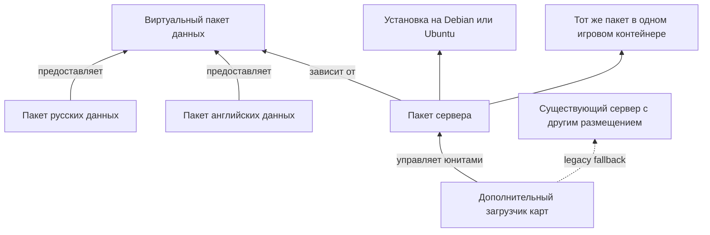

# Исследовательская заметка о пакетах и развёртывании Perfect World

Исследовательская запись предложений пользователя от 17 ноября 2026 года для обсуждения и будущей документации. Предполагаемый основной способ развёртывания — DEB-пакеты для хоста на Debian или Ubuntu. Docker-образ устанавливает те же пакеты и добавляет контейнерные overrides. Все игровые службы размещаются в одном игровом контейнере. MariaDB разворачивается отдельным сервисом.

Планируемая минимальная поставка включает устанавливаемые серверные пакеты и их контейнерный вариант. Разделение слоёв позволяет обновлять ассеты независимо и использовать их с другой реализацией сервера. Возможное дальнейшее направление — собственная реализация версии 1.7.6 на Rust, поставляемая заменой среднего серверного DEB-пакета при использовании соответствующего комплекта данных. Это направление развития, а конкретная реализация потребует собственного проектирования.

## Слои пакетов

Названия ниже — рабочие обозначения. Окончательные имена пакетов, служб и общего target предстоит выбрать.

| Слой | Содержимое и назначение |
| --- | --- |
| `Perfect World Data <Language>` | Языковой комплект игровых данных и ассетов. Возможные варианты — русский, английский и другие языки. Пакет предоставляет виртуальный `Perfect World Data`. |
| `Perfect World Server` | Серверные бинарники, конфигурационные файлы, шаблоны конфигурации, systemd-юниты и настройки группировки процессов. Зависит от `Perfect World Data`. |
| Дополнительный загрузчик карт | Отдельный пакет с собственной службой. Управляет загрузкой и выгрузкой карт, ожиданием готовности и клиентским ожиданием. Рабочие варианты названия — `Perfect World Lazy Maps`, `Perfect World Maps Loader` или короткое имя, которое выберем позже. |

### Языковые данные

Языковой пакет содержит только игровые данные, специфичные для выбранного языка, и ассеты соответствующего комплекта. Бинарники и конфигурация служб входят в серверный слой. Возможность зависимости от виртуального пакета позволяет выбирать языковой комплект для установки сервера.

Общность серверных бинарников исследуется между локализациями одной версии игры. Версии 1.7.6, 1.7.2 и другие рассматриваются как отдельные наборы совместимости. Возможность совместного использования бинарников и языковых ресурсов внутри выбранной версии требует проверки. В проведённом исследовании подтверждены языковые варианты `aipolicy` и `tasks`, у части вариантов отличаются также параметры и состав записей. [Исследование языковых данных](server-locales.ru.md) · [Проверка серверных бинарников](server-binary-locales.ru.md)

Размещение общих ресурсов, одинаковых для нескольких языков, нужно уточнить при составлении пакетов. Это относится в том числе к общим данным мира и карт.

### Серверный пакет

Пакет сервера устанавливает бинарники, конфиги и их шаблоны, юниты для служб и группировку процессов через systemd и cgroups. Для отдельного серверного процесса предусматривается собственная служба.

Карты запускаются параметризованным юнитом. Условный пример — `perfectworld-map@gs01.service`, где экземпляр задаёт алиас карты. Через этот экземпляр выполняются запуск, остановка и предусмотренный политикой перезапуск соответствующего процесса `gs`.

В базовой сборке администратор запускает карты через systemd. Запущенная карта продолжает работать до явной остановки. Автоматический выбор момента загрузки и выгрузки выполняет дополнительный пакет загрузчика.

Общий systemd-target служит верхнеуровневой точкой запуска всего серверного набора. Зависимости между юнитами задают порядок запуска связанных служб. Для отдельных служб и окружений предусматриваются overrides и возможность настройки через конфигурационные шаблоны.

Основной мир обслуживается полным `gs01`, как выбрано по результатам опытов с картами. [Результаты экспериментов с картами](../experiments/maps/README.md)

### Дополнительный загрузчик карт

Загрузчик карт устанавливается отдельным пакетом поверх базового серверного окружения и работает собственной службой systemd. Базовый сервер можно использовать самостоятельно, управляя экземплярами карт вручную.

В штатном режиме загрузчик обращается к systemd и запускает или останавливает существующие юниты карт. Systemd обслуживает жизненный цикл процессов, а загрузчик определяет, когда карта нужна и когда её можно выгружать.

В функции загрузчика входят ожидание готовности карты и маршрута, затемнение при телепортации и отображение ожидания при входе на выгруженную карту. Отправной точкой служат уже проведённые эксперименты. Их код предстоит оформить в самостоятельную поддерживаемую службу. [Вход на холодную карту](../experiments/maps/map-login-autoload/map-autoload-experiment.ru.md) · [Телепорт с затемнением](../experiments/maps/cold-teleport/map-teleport-experiment.ru.md)

Требуется поддержка legacy fallback для существующих серверов с другим размещением файлов и другим способом управления процессами. Конкретный механизм fallback предстоит выбрать. Зависимости DEB-пакета загрузчика нужно согласовать с установкой поверх такого legacy-сервера.

## Хост и контейнер

Основной вариант установки — DEB-пакеты на хост Debian или Ubuntu. Контейнерный вариант строится установкой тех же пакетов в образ и применением настроек для контейнерного окружения.

Игровые процессы работают внутри одного контейнера с общими локальными путями и IPC. Для проверенных внутренних GNET stream-связей выбраны штатные Unix-сокеты. MariaDB остаётся отдельным сервисом с подключением по TCP. [Проверки Unix-сокетов с клиентом](../experiments/server-ipc/client-check.ru.md)

Контейнерный профиль должен обеспечить запуск служб systemd, работу cgroups, постоянное хранение WDB и корректную передачу остановки игровому серверу. Конкретный запуск systemd внутри контейнера, необходимые параметры окружения и overrides предстоит определить и проверить. [Контейнерный интерфейс systemd](https://systemd.io/CONTAINER_INTERFACE/) · [Измеренные файловые и сетевые контракты](runtime-contracts.ru.md)

Точные версии поддерживаемых Debian и Ubuntu, базовый Docker-образ и зависимости пакета выбираются при подготовке первой сборки. Для текущих ELF подтверждён ABI glibc и потребность в комплекте совместимых библиотек. [Проверенные файлы и библиотеки](image-files.ru.md)

## Репозиторий и публикация

В репозитории хранятся исходники упаковки и управляющих компонентов, шаблоны конфигураций, systemd-юниты, инструкции и результаты проверок.

Серверные бинарники и игровые данные поставляются в собранных DEB-пакетах. Пакеты собираются локально из подготовленного комплекта файлов и публикуются как артефакты GitHub Releases. Бинарники и ассеты поставляются через эти релизы.

Первая поставка включает минимальные серверные пакеты и контейнерный вариант на их основе. Дополнительный загрузчик карт развивается отдельным слоем.

## Версионирование и дальнейшие решения

Отдельно нужно согласовать следующие вопросы.

- Окончательные имена пакетов, виртуального пакета данных, юнитов и загрузчика карт.
- Формат версий, назначение major/minor и ревизии упаковки, соотношение версии игрового комплекта и пакета, а также старшинство вариантов с `~` и `+`.
- Состав языковых пакетов, размещение общих ресурсов и совместимость версий данных с серверным пакетом.
- Механизм конфигурационных overrides для хоста и контейнера, а также окружение systemd и cgroups внутри Docker.
- Механизм legacy fallback и зависимости пакета загрузчика для существующей установки сервера.

При подготовке юнитов нужно учесть установленные экспериментами условия готовности карты, сохранения персонажей и завершения WDB. У штатных процессов разные способы остановки, встречаются групповые сигналы. Порядок запуска служб и готовность игрового маршрута требуют соответствующих проверок. [Справочник запуска и остановки](server-configuration.ru.md) · [Маршруты и завершение карт](maps.ru.md) · [Хранилища и восстановление](storage-and-recovery.ru.md)

## Порядок дальнейшей работы

1. Исследовать переносимость путей ко всем входным и выходным файлам, рабочие каталоги и встроенные абсолютные пути.
2. Проверить владельцев, группы и режимы доступа для бинарников, данных, конфигураций, WDB, журналов и сокетов. Установить, какие пути требуют чтения и записи и как службы работают с выбранными правами.
3. Проверить совместимость бинарников с разными локализациями в пределах одной версии игры.
4. Подготовить подробную документацию о работе оригинального Perfect World по шаблону, который задаст пользователь. Писать небольшими частями, вплоть до отдельных абзацев, проверять сведения и получать ревью пользователя.
5. При необходимости дополнить документацию небольшой схемой предполагаемой собственной архитектуры. Дальнейшее проектирование пакетов опирается на описанное поведение оригинального сервера.

Исследовательские заметки и протоколы опытов в `research/` и `experiments/` служат рабочим контекстом и доступны пользователю для чтения. Пользователь разрешил агенту самостоятельно оформлять и коммитить эти материалы. Для подробной документации оригинального сервера предусмотрено отдельное поэтапное ревью.

Архитектура админ-панели обсуждается отдельно.
