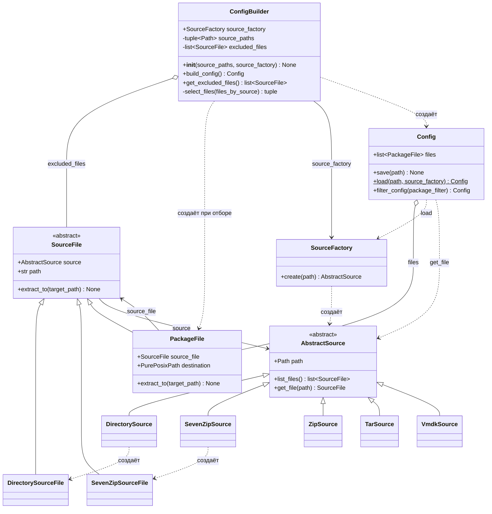
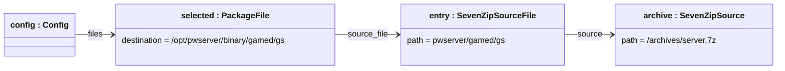

# Классы и объекты сборщика DEB

Согласованная схема классов сборщика. Общий сценарий упаковки описан в [архитектуре билдера](package-builder-proposal.ru.md), правила отбора собраны в [оценке файлов сервера](pwserver-files-review.ru.md).

## Диаграмма классов

`PackageFile` наследуется от абстрактного `SourceFile` и хранит ссылку `source_file` на исходный экземпляр. Свойства `source` и `path` возвращают значения этого экземпляра. Вызов `extract_to(target_path)` передаётся ему с тем же рабочим путём на диске. `destination` хранит назначение внутри пакета. Подготовка пакета преобразует это назначение в рабочий путь.

`Config` хранит выбранные `PackageFile`. Метод `save` записывает в JSON абсолютный путь источника, путь записи и назначение. Метод `load` получает `SourceFactory`, создаёт один ридер на источник и восстанавливает записи через `AbstractSource.get_file(path)`.

`SourceFactory` живёт в `libs.sources` рядом с ридерами. `create(path: Path) -> AbstractSource` выбирает реализацию для каталога, 7z, ZIP, TAR или VMDK. Та же фабрика используется при создании и при загрузке конфига.

## Отбор и фильтрация конфига

`ConfigBuilder(source_paths, source_factory)` принимает список путей к источникам и фиксирует их порядок на время жизни экземпляра. Другой набор путей получает свой экземпляр билдера.

`ConfigBuilder.build_config() -> Config` открывает источники из сохранённого списка и передаёт файлы внутреннему методу отбора. Отбор определяет назначения, выбирает варианты и создаёт `PackageFile` для общего конфига. Исключённые `SourceFile` сохраняются в этом же экземпляре после успешного построения.

`get_excluded_files() -> list[SourceFile]` возвращает копию списка исключённых последнего успешного построения. До первого построения список пуст. Следующее успешное построение заменяет список. CLI может использовать этот метод для вывода `--exclude`.

`Config.filter_config(package_filter) -> Config` применяет предикат `PackageFile -> bool` и возвращает новый конфиг. В нём остаются ссылки на выбранные `PackageFile` в прежнем порядке. Это позволяет получить серверный конфиг и конфиг данных из одного общего.

## Пример связанных объектов

## Выбор паттернов

- Адаптеры источника и исходного файла задают общие операции перечисления, восстановления записи и извлечения. Отдельные типы исходного файла оправданы, когда у них различается реализация `extract_to`. При одинаковом делегировании источнику достаточно общей реализации.
- `PackageFile` использует декоратор для `SourceFile`. Он добавляет назначение пакета и делегирует операции исходному экземпляру.
- `SourceFactory` сосредоточивает выбор ридера в одном методе. Если понадобятся настройки чтения, например выбор раздела VMDK, их можно передать фабрике при создании.
- Интерактивный режим и пресеты используют общий отбор `ConfigBuilder`. Способ выбора варианта можно передать как метод объекта.
