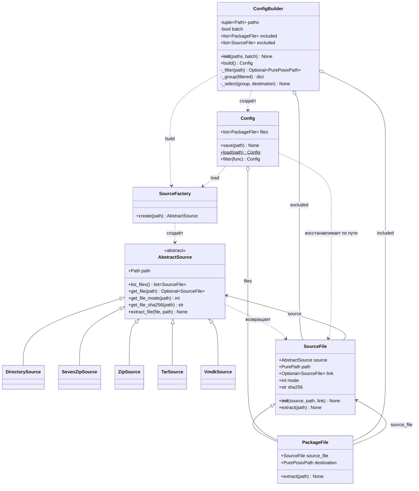
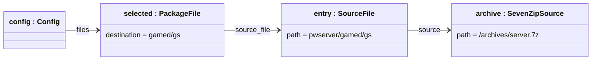

# Классы и объекты сборщика DEB

Согласованная схема классов сборщика. Общий сценарий упаковки описан в [архитектуре билдера](package-builder-proposal.ru.md), правила отбора собраны в [оценке файлов сервера](pwserver-files-review.ru.md).

## Диаграмма классов



`SourceFile` — общий класс для всех форматов. Адрес записи и цель ссылки имеют тип `PurePath`. Для файлов каталога ридер передаёт `Path`, для записей архива — `PurePosixPath`. Ридер передаёт в `SourceFile` готовую цель в пространстве имён источника. Свойство `link` получает следующий файл через `AbstractSource.get_file()` по сохранённому пути. Чтение режима, хеширование и извлечение рекурсивно переходят к конечному файлу. Свойство `mode` возвращает режим файла как целое число. Для `DirectorySource` это полное значение `st_mode`. При отборе исполняемых файлов билдер будет проверять один бит исполнения.

`get_file` возвращает `None`, если путь не указывает на подходящий файл. `AbstractSource` разрешает путь к ресурсу при создании. `DirectorySource` принимает существующие файлы внутри разрешённого корня и ссылки на них. Ошибки проверки пути передаются вызывающему коду.

`PackageFile` наследуется от `SourceFile` и хранит ссылку `source_file` на исходный экземпляр. Конструктор инициализирует унаследованные поля из исходного файла, включая сохранённый путь цели симлинка. Свойства наследуются от `SourceFile`. `destination` хранит относительное назначение внутри пакета. Метод `extract(path)` принимает каталог сервера. Например, для `destination` равного `gamed/gs` и каталога `/opt/pwserver/binary` итоговый путь будет `/opt/pwserver/binary/gamed/gs`.

`Config` хранит выбранные `PackageFile`. В JSON ключ верхнего уровня задаёт путь источника. Внутри группы путь записи сопоставляется с относительным назначением в пакете.

```json
{
  "path/to/archive.zip": {
    "path/inside/gamed/gs": "gamed/gs"
  }
}
```

Метод `load(path)` создаёт `SourceFactory` и один ридер на источник, затем восстанавливает файлы по сохранённым путям. Если файл отсутствует в источнике, ошибка возникает при извлечении.

`SourceFactory` живёт в `libs.sources` рядом с ридерами. `create(path: Path) -> AbstractSource` выбирает реализацию для каталога, 7z, ZIP, TAR или VMDK. Та же фабрика используется при создании и при загрузке конфига.

## Отбор и фильтрация конфига

`ConfigBuilder(paths, *, batch: bool = False)` запоминает пути к источникам в порядке приоритета и режим выбора. Вызывающий код явно запускает `build() -> Config` один раз для каждого экземпляра.

`included` содержит выбранные `PackageFile`, `excluded` содержит исключённые `SourceFile`. CLI читает эти списки для `--include` и `--exclude`. `Config` использует список `included` этой сборки.

`build()` открывает источники через `SourceFactory` и передаёт исходный `SourceFile.path` в `_filter(path)` напрямую. Путь относится к пространству имён источника. Например, абсолютный путь может указывать на файл внутри диска ВМ. `_filter` возвращает распознанный серверный путь или `None`.

`_group(filtered)` получает кандидатов, собранных по распознанным путям, и возвращает группы с окончательными относительными назначениями. Например, варианты `aipolicy` образуют одну группу с назначением `gamed/config/aipolicy.data`.

`_select(group, destination)` получает одну группу и её окончательный путь. Метод создаёт `PackageFile` для выбранных кандидатов и обновляет списки `included` и `excluded`.

`Config.filter(func) -> Config` применяет предикат `PackageFile -> bool` и возвращает новый конфиг с выбранными `PackageFile` в прежнем порядке. `build server`, `build data` и `build locale` используют его, чтобы выбрать свою часть готового конфига по `destination`. Исходные кандидаты уже сгруппированы и выбранные варианты сохранены. [Команды подготовки](package-builder-proposal.ru.md#команды-подготовки)

## Пример связанных объектов



## Выбор паттернов

- Адаптеры источника реализуют операции чтения для своих форматов. Общий `SourceFile` обращается к адаптеру по адресу записи.
- `PackageFile` наследует свойства `SourceFile`, хранит ссылку на исходный файл и применяет назначение внутри пакета при извлечении.
- `SourceFactory` сосредоточивает выбор ридера в одном методе. Если понадобятся настройки чтения, например выбор раздела VMDK, их можно передать фабрике при создании.
- Интерактивный режим и пресеты используют общий отбор `ConfigBuilder`. Способ выбора варианта можно передать как метод объекта. В `build config` флаг `--batch` предназначен для выбора вариантов без запросов пользователю. SHA-256 вариантов вычисляется только непосредственно перед интерактивным запросом выбора.
