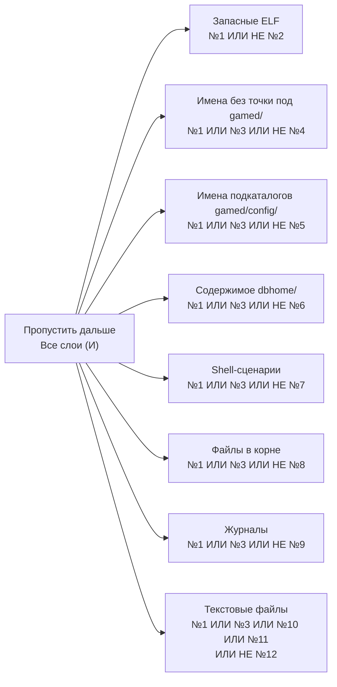
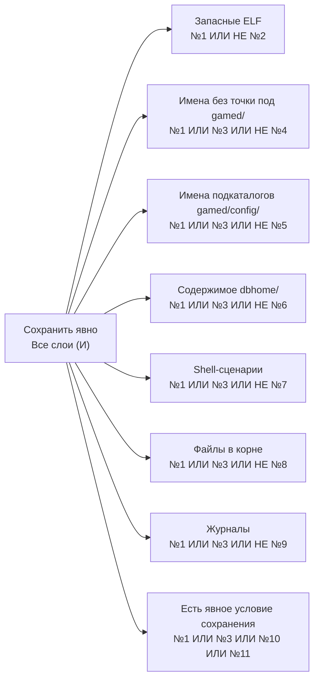
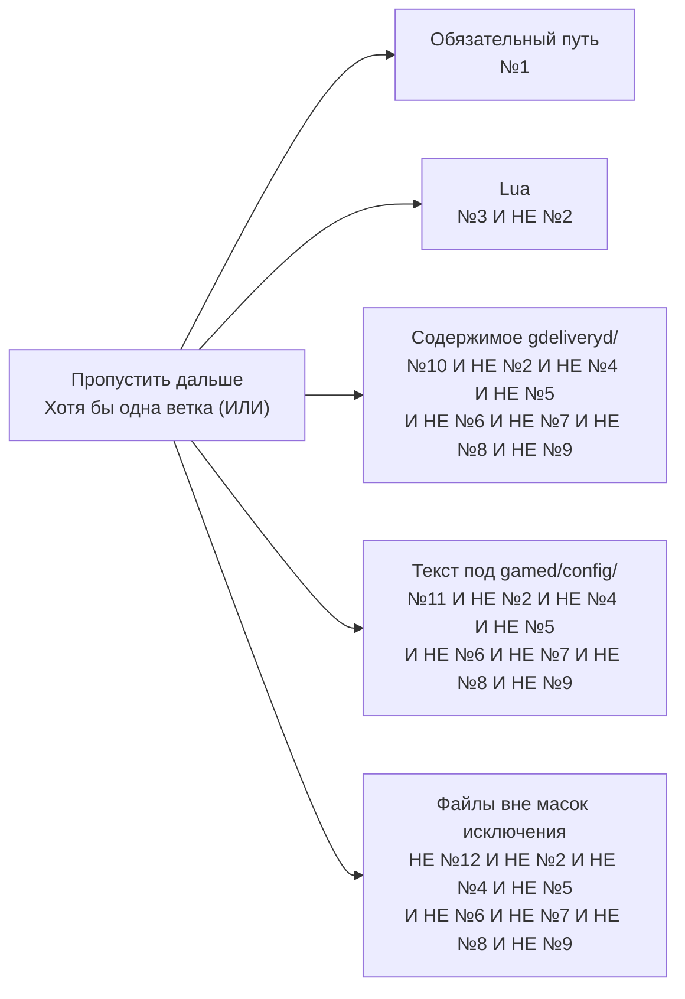
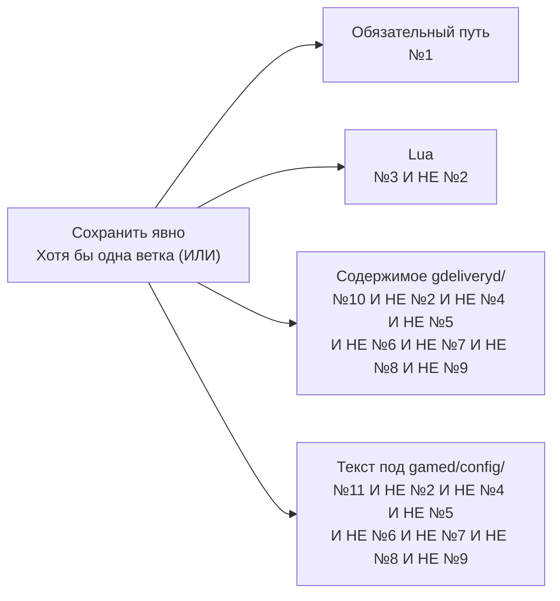

# КНФ и ДНФ для отбора файлов сборщика

В схемах путь уже приведён к виду относительно `pwserver/`, на вход поступают только файлы. Исходные решения берём из двух таблиц исследования Linear. Их порядок — от №1 к №12, первое совпадение определяет решение, остальные пути остаются на разборе. [Правила отбора](pwserver-files-review.ru.md#что-удалить-из-сборки)

## Что означает ответ «да»

| Исход в исследовании | Файлов | Пропустить дальше | Сохранить явно | Пропустить запись при обходе |
| --- | ---: | --- | --- | --- |
| Сохранить | 32 | Да | Да | Нет |
| Исключить | 258 | Нет | Нет | Да |
| Оставить на разборе | 3 986 | Да | Нет | Нет |

В четырёх схемах «пропустить» означает **передать файл дальше как кандидата**. Ответ «да» для «сохранить» означает **есть явное решение включить файл**. В конце приведены обе формы для смысла «пропустить запись при обходе».

## Условия по файлам

Каждый номер обозначает одну проверку пути. `№4` читается как «путь совпал с условием №4», `НЕ №4` — как «путь не совпал». Один `fullmatch` может проверять и маску с альтернативами. Например, для №9 три шаблона журнала соединяются через `|`.

| № | Когда условие истинно | Решение при первом совпадении |
| ---: | --- | --- |
| 1 | Путь совпадает с одним из десяти штатных ELF или с `gamed/config/filters`. | Сохранить |
| 2 | К точному пути штатного ELF добавлен непустой хвост без точки и разделителей пути. | Исключить |
| 3 | Имя оканчивается на `.lua` на любой глубине дерева. | Сохранить |
| 4 | Файл находится под `gamed/`, в его имени нет точки. | Исключить |
| 5 | Файл находится в подкаталоге `gamed/config/`, в имени первого подкаталога есть символ вне `[A-Za-z0-9]`. | Исключить |
| 6 | Файл находится внутри каталога `dbhome`, в том числе во вложенной папке. | Исключить |
| 7 | Имя оканчивается на `.sh`. | Исключить |
| 8 | Файл лежит непосредственно в корне `pwserver/`. | Исключить |
| 9 | Файл лежит под `logs/` либо его имя оканчивается на `.log` или `log.txt`. | Исключить |
| 10 | Файл находится под `gdeliveryd/`. | Сохранить |
| 11 | Имя оканчивается на `.txt`, файл находится в `gamed/config/` или ниже. | Сохранить |
| 12 | Имя оканчивается на `.txt` на любой глубине дерева. | Исключить |

Прежняя пара списков «запреты, разрешения» была сокращённой записью. Слой с запретами №7 и №9 и разрешениями №1 и №3 раскрывается в `(№1 ИЛИ №3 ИЛИ НЕ №7) И (№1 ИЛИ №3 ИЛИ НЕ №9)`. Ниже скобки записаны напрямую. В КНФ внутри слоя только `ИЛИ`, между слоями `И`. В ДНФ внутри ветки только `И`, между ветками `ИЛИ`. `НЕ` относится к одному условию.

Если маски журналов хранить по отдельности, в КНФ слой №9 раскроется в три слоя с теми же №1 и №3. В ДНФ три отрицания масок войдут в ту же ветку через `И`.

## КНФ — пропустить дальше

Каждый слой должен дать «да». Например, `gamed/config/filters` проходит слой файлов без точки по №1. Тексты из `gdeliveryd/` или `gamed/config/` проходят слой `.txt` по №10 или №11, и для них проверяются остальные слои. Формулы отражают исходный порядок для любого пересечения условий, поэтому содержат и избыточные для текущих масок проверки. Например, файл `.lua` сам по себе не совпадёт с №4.



## КНФ — сохранить явно

Первые семь слоёв те же. Последний слой требует хотя бы одного из четырёх явных условий сохранения. Когда этот слой выполнен, ограничение для оставшихся `.txt` уже учтено.



## ДНФ — пропустить дальше

Достаточно одной ветки. Штатный путь проходит сразу. Lua проходит при отсутствии совпадения с №2. Для `gdeliveryd/` и текстов из `gamed/config/` перечислены более ранние условия исключения, с которыми путь должен разойтись. Последняя ветка допускает в том числе файлы, по которым решение пока открыто.



## ДНФ — сохранить явно

Четыре ветки соответствуют четырём исходным правилам сохранения. Например, для файла из `gdeliveryd/` должны выполняться №10 и все перечисленные отрицания. Ветки могут совпасть одновременно, для явного сохранения достаточно одной.



## Проверка на путях Linear

| Путь | Совпавшие условия | Пропустить дальше | Сохранить явно | Почему |
| --- | --- | --- | --- | --- |
| `gamed/config/filters` | №1, №4 | Да | Да | Точный путь имеет приоритет. |
| `gdeliveryd/lualog.txt` | №9, №10, №12 | Нет | Нет | Правило журналов срабатывает раньше правила каталога службы. |
| `gamed/config/world/world_targets.txt` | №11, №12 | Да | Да | Текст под `gamed/config/` разрешён раньше общего правила `.txt`. |
| `gamed/config/world/watermap/1.wmap` | Ни одного | Да | Нет | Путь открыт для дальнейшего отбора. |

Обе формы сравнили с исходным порядком для всех 4 096 сочетаний результатов двенадцати проверок. На 4 276 файловых записях Linear результаты совпали с CSV по каждому пути. Дальше проходят 4 018 кандидатов, среди которых 32 с явным решением сохранить. [CSV с оценкой](evidence/pwserver-files/assessment.csv)

## Если «пропустить» означает «исключить запись»

«Исключить запись» — отрицание «пропустить дальше». По законам де Моргана меняем `И` и `ИЛИ` местами, у каждого условия меняем знак. КНФ исключения получается из ДНФ пропуска дальше, а ДНФ исключения из КНФ пропуска дальше.

```text
КНФ — исключить запись
    (НЕ №1)
И   (НЕ №3 ИЛИ №2)
И   (НЕ №10 ИЛИ №2 ИЛИ №4 ИЛИ №5 ИЛИ №6 ИЛИ №7 ИЛИ №8 ИЛИ №9)
И   (НЕ №11 ИЛИ №2 ИЛИ №4 ИЛИ №5 ИЛИ №6 ИЛИ №7 ИЛИ №8 ИЛИ №9)
И   (№12 ИЛИ №2 ИЛИ №4 ИЛИ №5 ИЛИ №6 ИЛИ №7 ИЛИ №8 ИЛИ №9)

ДНФ — исключить запись
    (НЕ №1 И №2)
ИЛИ (НЕ №1 И НЕ №3 И №4)
ИЛИ (НЕ №1 И НЕ №3 И №5)
ИЛИ (НЕ №1 И НЕ №3 И №6)
ИЛИ (НЕ №1 И НЕ №3 И №7)
ИЛИ (НЕ №1 И НЕ №3 И №8)
ИЛИ (НЕ №1 И НЕ №3 И №9)
ИЛИ (НЕ №1 И НЕ №3 И НЕ №10 И НЕ №11 И №12)
```

## Что проще читать

Для допуска кандидатов КНФ показывает отдельные ограничения по типам файлов. Для явного сохранения ДНФ показывает четыре причины включения и видимые условия приоритета. При добавлении общего исключения в ДНФ нужно проверить несколько веток, а в КНФ читается слой, к которому относится ограничение.

Обе формы можно хранить как список списков. Каждый элемент — проверка маски со знаком, форма задаёт два оператора для всего списка. Порядок вычисления строк свободный, приоритет исходных правил уже выражен условиями.

## Группировка перед фильтрацией

Glob-маски для предпросмотра готовы. Следующий коммит реализует `_group()`. Таблица правил сопоставляет распознанные игровые пути с итоговыми назначениями. Один итоговый путь обозначает один вход загрузчика или штатное имя программы. При объединении кандидатов учитываем заданный порядок источников. Одноимённые копии с одним распознанным путём уже собираются в общий список в `build()`. [Схема билдера](package-builder-file-flow.ru.md#отбор-и-фильтрация-конфига)

Слои фильтрации реализуем после группировки. Во время сборки они применяются перед `_group()`. У каждого слоя свой список запретов и разрешений. Файл проходит слой, когда ни один запрет не совпал или совпало разрешение этого слоя, а до группировки доходят файлы, прошедшие все слои. Старое правило исключало запасные исполняемые файлы по имени. В новой схеме известные варианты остаются кандидатами. Например, и `gamed/gs`, и известные `gamed/gs_v*` проходят слой файлов без точки по локальному разрешению. `_select()` выбирает один вариант, в batch-режиме штатный файл имеет приоритет при наличии. [Исходное решение о запасных файлах](pwserver-files-review.ru.md#что-удалить-из-сборки)

### Кандидаты из Linear

| Итоговый путь | Дополнительные имена в том же каталоге | Всего со штатным | Основание для выбора |
| --- | --- | ---: | --- |
| `gamed/config/aipolicy.data` | Шесть `aipolicy-176-*.data` с метками 5124 и 5385 для CN, EN и RU. | 7 | Один вход `PolicyData`. Штатный файл совпадает по SHA-256 с `5124-ru-pure`. |
| `gamed/config/tasks.data` | Три `tasks-176-*.data` формата 191 для BR, CN и RU. | 4 | Один вход `QuestPackage`. Штатный файл совпадает по SHA-256 с `21606-v191-ru`. |
| `gamed/config/elements.data` | `elements-orig.data`, `elements-bug list 302.data`. | 3 | Один вход `itemDataFile`. Формат совпадает, вариант нужно сверить с клиентом. |
| `gamed/config/rare_item.conf` | `rare_item2.conf`. | 2 | Один вход `RareItem`. Оба списка соответствуют формату, содержат 833 и 17 ID соответственно. |
| `gamedbd/clsconfig` | `clsconfig-o`, `clsconfig_176_pure`. | 3 | Один вход импорта классов. Чистый запуск проверяли со штатным файлом. |
| `gamed/gs` | `gs_v1`, `gs_v2`, `gs_v3`. | 4 | Варианты одного игрового процесса. |
| `gamedbd/gamedbd` | `gamedbd1`. | 2 | Запасной ELF рядом со штатным. |
| `gdeliveryd/gdeliveryd` | `gdeliveryd1`. | 2 | Запасной ELF рядом со штатным. |
| `gfactiond/gfactiond` | `gfactiond1`. | 2 | Запасной ELF рядом со штатным. |
| `glinkd/glinkd` | `glinkd!!!`. | 2 | Запасной ELF рядом со штатным. |
| `uniquenamed/uniquenamed` | `uniquenamed1`. | 2 | Запасной ELF рядом со штатным. |

[Входы загрузчиков](dynamic-resources.ru.md#выбор-варианта-одного-ресурса) · [Совпадения языковых файлов](server-locales.ru.md) · [Запасные ELF и их пути](evidence/pwserver-files/summary.json)

У `dyn_tasks.data` отдельное назначение `QuestPackage2`. У `gshop.data`, `gshop1.data` и `gshop2.data` три собственных входа загрузчика, GS открывает их в одном запуске. Файлы `npcgen` составной карты также сохраняют свои пути. [Составные наборы](dynamic-resources.ru.md#магазины-и-составные-наборы)

### План коммита по группировке

1. Реализовать `_group()` в `builder/src/libs/config/config_builder.py` с текущим входом и выходом `dict[PurePosixPath, list[SourceFile]]`. Правило ниже ищет самое длинное существующее базовое имя в том же каталоге с тем же расширением. Путь без подходящей основы остаётся самостоятельным. Первый шаг для ревью проверяет, что семь файлов `aipolicy` попадают в одну группу `gamed/config/aipolicy.data`.
2. Добавить исключения ниже и проверить `gshop`, `domain` и все 128 файлов `npcgen_<номер>.data`. Соседние игровые файлы с собственными штатными именами сохраняют назначения.
3. Поместить кандидатов со штатным именем первыми в каждой группе, чтобы существующий `_select()` выбирал штатный вариант. Среди кандидатов с одинаковым именем сохранять порядок входных источников. Проверить две копии `aipolicy.data` из двух источников.
4. Проверить группы на Linear через `build config` с флагами `--include --exclude --show 'aipolicy*.data' --show 'tasks*.data' --show 'gs*'`. Ожидаются группы из 7, 4 и 4 кандидатов соответственно, по одному штатному назначению для каждой. Сверить независимые файлы и запустить Ruff.

### Подбор базового имени и исключения

Кандидаты проверяются одним шаблоном хвоста. `-` и `_` могут начинать хвост или входить в само базовое имя.

```python
r"[^A-Za-z/.][^/.]*(?P<suffix>\.data|\.conf|)"
```

Пробуем срезы имени справа налево. Берём самый длинный базовый путь, который уже есть среди кандидатов из всех источников, с тем же каталогом и расширением. Например, `aipolicy_176_cn.data` и `aipolicy-176-cn.data` найдут `aipolicy.data`, а `rare_item2.conf` найдёт `rare_item.conf`. Если подходящего базового пути нет, ключом группы служит собственный путь файла.

Исключения задаём точными путями и масками имён. Они сохраняют собственное назначение самостоятельных ресурсов. Одноимённые копии из разных источников образуют группу по своему пути.

```text
gamed/config/gshop1.data
gamed/config/gshop2.data
gamed/config/gshop3.data
gamed/config/domain2.data
gamed/config/domain2_cross.data
gdeliveryd/domain2.data
```

Маску `npcgen_\d+\.data` применяем через `fullmatch` к имени файла. В Linear она охватывает 128 нумерованных фрагментов, по 64 в `random03` и `random04`.

Сверка по описи Linear показала 146 возможных замен по самому длинному базовому имени. Точные исключения убрали шесть совпадений среди магазинов и доменов, а маска — 110 совпадений среди фрагментов карт, например `npcgen_10.data` → `npcgen_1.data`. Осталось 30 пар-кандидатов, в том числе `a108/npcgen-orig.data` → `a108/npcgen.data`. [Опись Linear](evidence/pwserver-files/assessment.csv) · [Как GS загружает фрагменты и магазины](dynamic-resources.ru.md#магазины-и-составные-наборы)

Повторная сверка по сохранённому `config.json` Linear дала те же 30 возможных замен для 16 назначений. Три совпадения относятся к `gshopsev*.data` в `gamed/config/мусор/`. Исключение этой подпапки относится к будущим слоям фильтрации. [Пофайловые решения](pwserver-files-review.ru.md#что-удалить-из-сборки)

### Резервные копии игровых ресурсов

В `gamed/config/` резервные копии проверены по маскам `.*\.bak` и `.*\.data[^/.]+` через `fullmatch` имени. Проверка хвоста `data[^/.]+` дала тот же единственный путь и с точкой перед `data`, и без неё. Разрешающий список расширений ниже исключает обе категории.

| Исключить из пакета | Штатный путь |
| --- | --- |
| `gamed/config/a06/npcgen.data.bak` | `gamed/config/a06/npcgen.data` |
| `gamed/config/a77/npcgen.data.bak` | `gamed/config/a77/npcgen.data` |
| `gamed/config/a78/movemap/15.rmap.bak` | `gamed/config/a78/movemap/15.rmap` |
| `gamed/config/a97/npcgen.dataBAC` | `gamed/config/a97/npcgen.data` |
| `gamed/config/мусор/movemap/15.rmap.bak` | `gamed/config/мусор/movemap/15.rmap` |

В 365 прочитанных конфигах и сценариях из `PWServer176.7z` ссылок на эти имена нет. Единственный ключ `NPCGenFile` задан как `npcgen.data`, `MapResManager::Init` добавляет к нему путь карты. `NPCMoveMap` берёт размеры из `movemap.conf` и строит имена вида `%d.rmap`, включая `15.rmap`. У копии в `a06` совпадают размер и CRC32 со штатным файлом, у остальных копий CRC32 отличается. Путь под `gamed/config/мусор/` уже исключался в исходной оценке по имени каталога. [Опись Linear](evidence/pwserver-files/assessment.csv) · [Параметры загрузчика NPC](dynamic-resources.ru.md#как-gs-выбирает-данные-и-карту) · [Шаблоны навигации](evidence/pwserver-files/world-movemap-manifest.json)

### Расширения из config.json

Для части ресурсов расширение входит в имя, которое строит код. В ELF `gamed/gs` Build 4311 найдены шаблоны `%d.hmap`, `%d.wmap`, `%d.rmap`, `%d.dhmap`, `%d.octr`, `%d.bht` и `npcgen_%d.data`. Имена файлов высот, воды, навигации, воздушных карт, коллизий и NPC-фрагментов строятся по этим шаблонам. [Загрузчик фрагментов](https://github.com/huzeming/176source/blob/c0992a29c0848de4de139a8958ceb11edcf2d38b/cgame/gs/mapresman.cpp#L195-L233) · [Навигация](https://github.com/huzeming/176source/blob/c0992a29c0848de4de139a8958ceb11edcf2d38b/cgame/gs/pathfinding/NPCMoveMap.cpp#L375-L392)

Для настраиваемых входов GS получает полные имена из `[Template]` и добавляет корень или путь карты. В архивном `gs.conf` указаны `NPCGenFile=npcgen.data`, `RegionFile=precinct.sev`, `RegionFile2=region.sev`, `PathFile=path.sev`, `MapDespFile=map_desp.sev`, `CollisionFile=map.bht`, `CollisionElement=wmgj.nmd` и `table_name=filters`. `CNPCGenMan::Load` открывает переданный путь через `fopen` и выбирает структуру по версии из заголовка файла. `PolicyData`, `QuestPackage` и `Mall*Data` тоже задают имена целиком. [Чтение NPCgen](https://github.com/huzeming/176source/blob/c0992a29c0848de4de139a8958ceb11edcf2d38b/cgame/gs/template/npcgendata.cpp#L65-L94) · [Имена из конфигурации GS](dynamic-resources.ru.md#как-gs-выбирает-данные-и-карту)

Списки собраны из текущего `builder/config.json` по последнему расширению пути назначения. Проверено 4 238 уникальных путей из одного источника. У 4 133 файлов есть одно из 28 расширений. 105 файлов без расширения оставлены для отдельного разбора.

Файл из списка «Сохраняем» проходит проверку расширения. Для `lualog.txt` и `gamedbd/1024.xml`, например, решение уточняется по пути. [Оценка отдельных файлов](pwserver-files-review.ru.md)

**Сохраняем** — 17 расширений, 4 112 файлов.

```text
.bht  .clt  .conf  .dat  .data  .dhmap
.hmap  .lua  .nmd  .octr  .rmap  .sev
.so  .sql  .txt  .wmap  .xml
```

**Удаляем из пакета** — 11 расширений, 21 файл.

```text
.682a5d18  .682b62ba  .68324e3e  .bak  .dataBAC  .empty
.log  .nbled  .orig  .rar  .sh
```

Все 122 `.clt` сохраняем как данные клиентского комплекта. Для серверной загрузки регионов в `gs.conf` заданы `.sev`. В H176 `LoadClt` находится в ветке `_ELEMENTCLIENT`, серверная ветка использует `LoadSev`. Все 21 упоминание `.clt` в `global_api.lua` — записи таблицы контрольных сумм клиентских путей. GS читает из `LuaData` номер версии в первой строке. [Ветки загрузчика карт](https://github.com/huzeming/176source/blob/c0992a29c0848de4de139a8958ceb11edcf2d38b/cgame/gs/template/el_randommapinfo.cpp#L246-L296) · [Чтение LuaData](https://github.com/huzeming/176source/blob/c0992a29c0848de4de139a8958ceb11edcf2d38b/cgame/gs/worldmanager.cpp#L1582-L1598)

`.so` сохраняем для других сборок ELF. Три `.dat` из `gacd/` оставляем до выяснения их потребителя. Оба `.sql` нужны для первоначальной подготовки БД. [Назначение файлов поставки](image-files.ru.md) · [Схемы и дампы](sql.ru.md)

Три шестнадцатеричных суффикса принадлежат `log.*` в `dbhome/dblogs/`. При реализации слой исключает это состояние по пути. `.log` — журнал службы, четыре `.sh` — сценарии исходной обвязки. [Решения об исключении](pwserver-files-review.ru.md#что-удалить-из-сборки)

Остальные 13 файлов относятся к резервным или дополнительным ресурсам карт. Маски `.bak` и `.dataBAC` разобраны выше. `a05/npcgen.rar` — RAR5 с другой редакцией `npcgen.data`, 604 202 байта и CRC32 `E0AA328F`. Штатный файл рядом имеет 606 883 байта и CRC32 `B0C98E31`. В 365 проверенных конфигах и сценариях Linear не найдены ссылки на эти файлы. Образец `a01/npcgen.data.empty` содержит заголовок NPCgen версии 4 с двумя нулевыми счётчиками. Его можно отдельно рассмотреть как вариант при явном выборе. [Опись Linear](evidence/pwserver-files/assessment.csv) · [Формат заголовка NPCgen](https://github.com/huzeming/176source/blob/c0992a29c0848de4de139a8958ceb11edcf2d38b/cgame/gs/template/npcgendata.h#L32-L39)

Файл `gamed/config/a97/Npcgen Dynamic Objects[68].nbled` имеет размер 1 669 байт и CRC32 `3B67234B`. Заголовок `Npcgen Editor by Luka||DynObject` и счётчик 68 сопровождаются 68 записями по 24 байта. Это экспорт динамических объектов для редактора. При штатном запуске GS загружает их из `npcgen.data`, поэтому экспорт исключаем из пакета. [Импорт и экспорт в редакторе](https://forum.ragezone.com/threads/npcgen-editor-by-luka.1124227/) · [Чтение динамических объектов GS](https://github.com/huzeming/176source/blob/c0992a29c0848de4de139a8958ceb11edcf2d38b/cgame/gs/template/npcgendata.cpp#L242-L274)

В полных описях Linear, Talolan, RuTracker и Sranus набор расширений внутри `gamed/config/` совпадает. У Sranus в этом каталоге на десять `.data` меньше. [Linear](evidence/pwserver-files/assessment.csv) · [Talolan](evidence/distributions/talolan-052025-vm-filesystem.csv) · [RuTracker](evidence/distributions/rutracker-012026-vm-filesystem.csv) · [Sranus](evidence/distributions/sranus-2025-tar-archive.csv)
