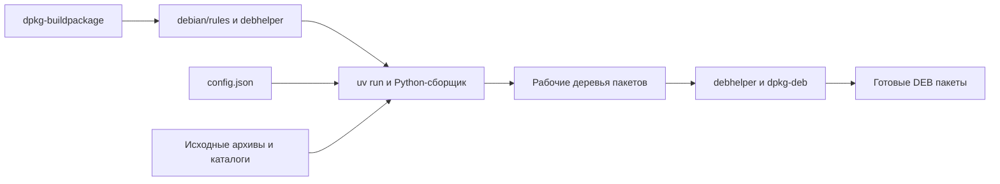

# Исследовательская архитектура сборщика DEB пакетов

Обсуждение начато 18 ноября 2026 года. Сборщик на Python с uv и Typer подготавливает серверный пакет, общие данные и пакет локали из выбранных источников. Выпуском DEB управляют `dpkg-buildpackage` и debhelper. [Состав трёх пакетов](package-data-split.ru.md#разбиение-для-первого-deb)

Это продолжение [предложения по пакетам и развёртыванию](package-architecture-proposal.ru.md). Состав файлов и решения по их отбору обсуждаются в [черновике оценки pwserver](pwserver-files-review.ru.md); описание сборщика не заменяет эти решения.

## Сценарий сборки

В WSL пользователь запускает `build config` с одним или несколькими источниками. Билдер распознаёт пути, группирует варианты, сохраняет выбранные файлы и их назначения в `config.json`. Этот конфиг становится входом для `dpkg-buildpackage`.

```sh
dpkg-buildpackage -b -us -uc
```

Правила `debian/rules` вызывают команды подготовки пакетов. Они читают сохранённый выбор, извлекают файлы из указанных источников и готовят рабочие деревья. Затем debhelper продолжает упаковку DEB. [Процесс dpkg-buildpackage](https://manpages.debian.org/bookworm/dpkg-dev/dpkg-buildpackage.1.en.html)



Рабочие деревья описывают будущие пути установленного пакета. Размещение в системе выполняется при последующей установке DEB. В debhelper предусмотрено распределение файлов между несколькими пакетами из общего дерева либо подготовка отдельных деревьев пакетов. [dh_install](https://manpages.debian.org/bookworm/debhelper/dh_install.1.en.html)

Исходная коллекция ресурсов остаётся только для чтения. Извлечение, отбор, переименование и выставление прав выполняются в отдельном рабочем каталоге. Основная область отбора — pwserver; панели и содержимое ОС из полного архива в состав игровых пакетов не входят. Из соседнего `root/sql` сборщик также копирует `licenseservice.sql` и `pw176.sql` в DEB с серверными бинарниками. [Инициализация MariaDB](package-architecture-proposal.ru.md#инициализация-mariadb)

## Роль Python и uv

Python выбран с учётом группировки вариантов файлов, интерактивного выбора, пользовательских пресетов, нескольких форматов архивов и тестов правил. Для последовательного копирования файлов Bash был бы достаточен; текущая задача включает работу с наборами записей и связанными решениями по ним.

uv управляет Python-окружением и запускает команды проекта. Зависимости будут объявлены в pyproject.toml, их точные выбранные версии — сохранены в uv.lock. Отсутствующий подходящий Python uv может загрузить сам. Отдельная предварительная установка системного Python для этого варианта не обязательна. [Проекты uv](https://docs.astral.sh/uv/guides/projects/), [установка Python](https://docs.astral.sh/uv/guides/install-python/)

Сборка с доступом к сети принята как рабочий сценарий. Требование запуска без сети не вводится. Для повторяемого выбора Python-зависимостей планируется хранить uv.lock и запускать команды с --locked; версия Python также должна быть согласована. --locked проверяет соответствие lock-файла метаданным проекта. Это не заменяет проверку воспроизводимости содержимого самих DEB. [Синхронизация и фиксация зависимостей](https://docs.astral.sh/uv/concepts/projects/sync/)

Предварительный uv build не требуется: uv run подготавливает окружение и запускает команду проекта. uv build предназначен для создания Python-дистрибутивов wheel и sdist. [Запуск проекта](https://docs.astral.sh/uv/guides/projects/#running-commands), [Python-дистрибутивы](https://docs.astral.sh/uv/concepts/projects/build/)

## Архивы и подготовка пакетов

В первом наборе форматов предполагаются 7z, ZIP, TAR и сжатые TAR. Для ZIP и TAR можно использовать стандартную библиотеку Python. Для 7z выбран подход через Python-библиотеку py7zr, устанавливаемую uv как зависимость проекта. В этом варианте внешний исполняемый файл 7z не требуется; поддержку и извлечение конкретного серверного архива ещё предстоит проверить. [Архивы в Python](https://docs.python.org/3/library/archiving.html), [py7zr](https://py7zr.readthedocs.io/en/latest/user_guide.html)

Формат архива и структура раздачи — разные свойства. Поддержка 7z или ZIP сама по себе не означает готовый разбор виртуальных дисков либо всех вложенных комплектов. Начальный исходный комплект — серверное дерево из Linear; дальнейшие варианты поставки потребуют проверки структуры.

### Команды подготовки

| Команда | Назначение |
| --- | --- |
| `build server` | Подготовить бинарники, нужные библиотеки и файлы серверного пакета |
| `build data` | Подготовить общие карты и другие совместимые ресурсы |
| `build locale` | Подготовить один выбранный комплект игровых `.data`, включая спавны |

Все три команды загрузят один JSON-конфиг и применят `Config.filter` по назначению `PackageFile`. Каждый выбранный файловый путь относится к одному пакету. Правила для готового конфига, включая исключения по конкретным путям, уточняются при реализации этих команд. [Состав пакетов](package-data-split.ru.md#разбиение-для-первого-deb) · [Интерфейс Config](package-builder-file-flow.ru.md)

`build config` остаётся отдельной командой. Она выбирает варианты из исходных архивов и каталогов. Флаг `--batch` включает выбор без запросов пользователю. Команды подготовки извлекают уже выбранные записи. Параметры пути конфига и каталога извлечения согласуем при реализации. [Команды Typer](https://typer.tiangolo.com/tutorial/commands/)

### Просмотр отбора в `build config`

- `--include` выводит выбранные файлы с источником, пакетом и путём назначения.
- `--exclude` выводит исключённые файлы с источником и причиной исключения.

Оба флага можно указать вместе. Просмотр применяет обычные правила отбора и выводит результат в консоль без записи конфига. С `--format json` результат идёт в stdout, а сообщения об ошибках — в stderr. При обычном запуске `build config` сохраняет JSON-конфиг.

## Вызов из debhelper

В debian/rules можно задать команды перед шагом, после него либо заменить реализацию шага. Для подготовки файлов рассматривается override_dh_auto_install. Это действие во время сборки; preinst и postinst относятся к жизненному циклу уже устанавливаемого пакета. [Точки расширения dh](https://manpages.debian.org/bookworm/debhelper/dh.1.en.html#OVERRIDE_AND_HOOK_TARGETS)

При подготовке DEB `override_dh_auto_install` вызывает через uv `build server`, `build data` и `build locale`. Все команды получают готовый конфиг и соответствующий рабочий каталог пакета. Порядок вызова и способ передачи путей уточняются при оформлении `debian/rules`.

Build-Depends исходного пакета объявляет инструменты сборочной среды. Зависимости установленного сервера задаются отдельно в Depends соответствующего бинарного пакета. uv и Python-библиотеки сборщика относятся к сборочной среде; в готовый игровой сервер они не включаются только на основании участия в сборке. dpkg-buildpackage проверяет сборочные зависимости; их установкой занимается подготовка окружения. [Зависимости Debian](https://www.debian.org/doc/debian-policy/ch-relationships.html#relationships-between-source-and-binary-packages-build-depends-build-depends-indep-build-depends-arch-build-conflicts-build-conflicts-indep-build-conflicts-arch)

На хосте сборки остаются нужны инструменты Debian. Для Python-части исходной зависимостью может быть uv, который загружает Python и библиотеки. Способ поставки uv в WSL нужно определить: исполняемый файл в PATH и установленный deb-пакет uv не являются одним и тем же условием для проверки Build-Depends.

Проверенная 18 ноября WSL по умолчанию — Pengwin на Debian 13 trixie. В её PATH uv не найден, установленный deb-пакет uv не обнаружен. Ранее проверенный uv запускался в Windows. Установка uv в WSL в рамках этого обсуждения не выполнялась.

## Содержимое установленного сервера

Python, uv, Typer, библиотека архивов и Python-окружение относятся к машине сборки. Серверный пакет не поставляет их и не объявляет их зависимостями своей работы. Для управления установленным базовым сервером используются systemd-юниты и собственные Bash-скрипты. Игровые бинарники, библиотеки, Lua, данные и конфигурации сохраняют распределение по согласованным слоям пакетов.

Systemd и Bash используются как системные компоненты целевой ОС. Их исполняемые файлы не требуется копировать из сборочного окружения в собственный пакет. Контейнерный вариант устанавливает те же серверные DEB и использует ту же границу между сборкой и работой сервера.

## Проверки и порядок реализации

Следующие изменения в `build config` идут отдельными коммитами.

1. Добавить флаг `--debug` для отладочного вывода файлов.
2. Реализовать группировку взаимозаменяемых вариантов по конечному пути.
3. Реализовать слои фильтрации кандидатов после проверки группировки.

Распределение выбранных файлов по пакетам уточняется при реализации трёх команд подготовки. [Группировка и фильтрация](package-builder-filter-rules.ru.md#группировка-перед-фильтрацией)

Правила отбора проверяются напрямую на небольших наборах файлов и архивах с известным содержимым. Команды, параметры и ввод пользователя проверяются через CliRunner Typer. Нужны проверки совпадения интерактивного выбора с эквивалентным пресетом и завершения неинтерактивной сборки без вопросов. [Тестирование Typer](https://typer.tiangolo.com/tutorial/testing/)

На реальном исходном комплекте предстоит проверить чтение и извлечение нужных ресурсов через библиотеку, выбранные варианты и итоговые имена, содержимое и права в пакетах, а затем установку готовых DEB. Производительность py7zr на нашем архиве пока не измерялась; переход на Python обоснован удобством логики и тестирования.

На момент записи существует отдельная незакоммиченная Python-заготовка: она вызывает внешний 7-Zip и создаёт пустой макет. Её проверки в Windows и WSL и создание макета из 4 276 серверных путей не являются проверкой реального извлечения библиотекой или готовой DEB-сборки. Проект uv с Typer и вызов из debhelper ещё не реализованы.

## Шаблоны для билдера и правила игнорирования

- Для каркаса CLI подходит штатный шаблон `uv init`. В готовом репозитории `python-cli-template` можно посмотреть, как вместе настроены Typer, Ruff, pytest и GitHub Actions. [Шаблоны uv](https://docs.astral.sh/uv/concepts/projects/init/#applications), [репозитории-шаблоны GitHub](https://docs.github.com/en/repositories/creating-and-managing-repositories/creating-a-repository-from-a-template), [пример CLI](https://github.com/st4rfox/python-cli-template)
- Для Python и uv отправная точка — `Python.gitignore` из коллекции GitHub. Для билдера пригодятся правила для `.venv/`, `__pycache__/`, `.ruff_cache/` и `.pytest_cache/`. `uv.lock` храним в Git для воспроизводимых установок. [Коллекция GitHub](https://github.com/github/gitignore), [шаблон Python](https://github.com/github/gitignore/blob/main/Python.gitignore), [файл блокировки uv](https://docs.astral.sh/uv/guides/projects/#uvlock)
- Для Bash правила зависят от того, какие журналы и временные файлы создают наши скрипты. В репозитории Bats есть пример исключений для отчётов и журналов тестов. [Файл игнорирования Bats](https://github.com/bats-core/bats-core/blob/master/.gitignore)
- Для Debian можно сверить служебные файлы debhelper и каталоги подготовки пакетов с правилами проекта APT. Наши исключения привяжем к фактическим выходным путям сборки. [Файл игнорирования APT](https://github.com/Debian/apt/blob/main/.gitignore), [справочник `dh`](https://manpages.debian.org/trixie-backports/debhelper/dh.1.en.html)
- Для Docker у Astral есть пример `.dockerignore`. Такой файл задаёт исключения из контекста сборки. Если Dockerfile устанавливает локально собранные DEB, их пути должны оставаться доступны для `COPY`. [Пример Astral](https://github.com/astral-sh/uv-docker-example/blob/main/.dockerignore), [правила Docker](https://docs.docker.com/build/concepts/context/#dockerignore-files)

Собственные исключения составим по фактическим путям локального конфига билдера, исходных раздач и результатов сборки.

## Отдельный вопрос об исполняемом файле

Поставка сборщика одним самостоятельным исполняемым файлом обсуждалась как вопрос, без решения переходить к реализации. uv build сам по себе такого файла не создаёт. Дополнительными инструментами могут быть PyInstaller или Nuitka; их можно запускать через uv. CPython — реализация Python, а Cython — отдельный инструмент перевода кода в C, который не выполняет автоматически полную упаковку зависимостей приложения. [PyInstaller](https://pyinstaller.org/en/stable/operating-mode.html), [Nuitka](https://nuitka.net/user-documentation/user-manual.html), [Cython](https://cython.readthedocs.io/en/latest/src/tutorial/embedding.html)

Первая версия запускается через `uv run`. Команда сборщика использует одну точку входа Typer, которую сможет вызывать будущий упаковщик. Предлагаемые коды завершения CLI — `0` при успехе, `1` при ошибке подготовки и `2` при неверных аргументах. Для явного завершения с нужным кодом команды используют `typer.Exit(code=...)`. [Завершение команд Typer](https://typer.tiangolo.com/tutorial/terminating/), [коды завершения Click](https://click.palletsprojects.com/en/stable/exceptions/)

Если появится исполняемый файл, проверим те же сценарии отдельным запуском этого файла и сравним коды с запуском через uv. При собственной обвязке CPython код операционной системе возвращает `main` запускателя через `return Py_RunMain();`. [Пример CPython](https://docs.python.org/3.13/c-api/init_config.html#c.Py_RunMain)

## Граница текущего сохранения

По указанию пользователя от 18 ноября коммиты и публикация на этом этапе ограничены материалами research/ и experiments/. Исходники, скрипты и остальные изменения вне этих каталогов пока не коммитятся и не отправляются в удалённый репозиторий.
