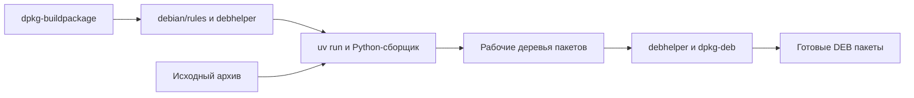

# Исследовательская архитектура сборщика DEB пакетов

Обсуждение от 18 ноября 2026 года. Согласованное направление — отдельный Python-проект с uv и CLI на Typer для подготовки серверного и языковых пакетов из исходной раздачи. Процессом выпуска DEB управляют штатные инструменты Debian: dpkg-buildpackage и debhelper. Имена проекта, команд и каталогов ниже предварительные.

Это продолжение [предложения по пакетам и развёртыванию](package-architecture-proposal.ru.md). Состав файлов и решения по их отбору обсуждаются в [черновике оценки pwserver](pwserver-files-review.ru.md); описание сборщика не заменяет эти решения.

## Сценарий сборки

Пользователь предоставляет архив сервера и запускает сборку в WSL. Архив может лежать рядом с исходниками сборщика; конкретный способ передачи его пути ещё нужно выбрать. Ожидаемая точка входа:

```sh
dpkg-buildpackage -b -us -uc
```

Сборка вызывает Python-утилиту через debian/rules. Утилита читает состав архива, применяет согласованные правила, извлекает нужные файлы и готовит рабочие деревья пакетов. Затем debhelper продолжает подготовку и вызывает упаковку DEB. [Процесс dpkg-buildpackage](https://manpages.debian.org/bookworm/dpkg-dev/dpkg-buildpackage.1.en.html)



Рабочие деревья описывают будущие пути установленного пакета. Размещение в системе выполняется при последующей установке DEB. В debhelper предусмотрено распределение файлов между несколькими пакетами из общего дерева либо подготовка отдельных деревьев пакетов. [dh_install](https://manpages.debian.org/bookworm/debhelper/dh_install.1.en.html)

Исходная коллекция ресурсов остаётся только для чтения. Извлечение, отбор, переименование и выставление прав выполняются в отдельном рабочем каталоге. Основная область отбора — pwserver; панели и содержимое ОС из полного архива в состав игровых пакетов не входят. Из соседнего `root/sql` сборщик также копирует `licenseservice.sql` и `pw176.sql` в DEB с серверными бинарниками. [Инициализация MariaDB](package-architecture-proposal.ru.md#инициализация-mariadb)

## Роль Python и uv

Python выбран с учётом группировки вариантов файлов, интерактивного выбора, пользовательских пресетов, нескольких форматов архивов и тестов правил. Для последовательного копирования файлов Bash был бы достаточен; текущая задача включает работу с наборами записей и связанными решениями по ним.

uv управляет Python-окружением и запускает команды проекта. Зависимости будут объявлены в pyproject.toml, их точные выбранные версии — сохранены в uv.lock. Отсутствующий подходящий Python uv может загрузить сам. Отдельная предварительная установка системного Python для этого варианта не обязательна. [Проекты uv](https://docs.astral.sh/uv/guides/projects/), [установка Python](https://docs.astral.sh/uv/guides/install-python/)

Сборка с доступом к сети принята как рабочий сценарий. Требование запуска без сети не вводится. Для повторяемого выбора Python-зависимостей планируется хранить uv.lock и запускать команды с --locked; версия Python также должна быть согласована. --locked проверяет соответствие lock-файла метаданным проекта. Это не заменяет проверку воспроизводимости содержимого самих DEB. [Синхронизация и фиксация зависимостей](https://docs.astral.sh/uv/concepts/projects/sync/)

Предварительный uv build не требуется: uv run подготавливает окружение и запускает команду проекта. uv build предназначен для создания Python-дистрибутивов wheel и sdist. [Запуск проекта](https://docs.astral.sh/uv/guides/projects/#running-commands), [Python-дистрибутивы](https://docs.astral.sh/uv/concepts/projects/build/)

## Архивы и подготовка пакетов

В первом наборе форматов предполагаются 7z, ZIP, TAR и сжатые TAR. Для ZIP и TAR можно использовать стандартную библиотеку Python. Для 7z выбран подход через Python-библиотеку py7zr, устанавливаемую uv как зависимость проекта. В этом варианте внешний исполняемый файл 7z не требуется; поддержку и извлечение конкретного серверного архива ещё предстоит проверить. [Архивы в Python](https://docs.python.org/3/library/archiving.html), [py7zr](https://py7zr.readthedocs.io/en/latest/user_guide.html)

Формат архива и структура раздачи — разные свойства. Поддержка 7z или ZIP сама по себе не означает готовый разбор виртуальных дисков либо всех вложенных комплектов. Начальный исходный комплект — серверное дерево из Linear; дальнейшие варианты поставки потребуют проверки структуры.

Предполагаются отдельные команды подготовки:

| Команда | Назначение |
| --- | --- |
| prepare-server | Подготовить выбранные серверные бинарники, библиотеки, Lua, штатные SQL-дампы, собственные конфиги и остальные согласованные файлы серверного пакета |
| prepare-data | Подготовить игровой комплект данных с выбранной локализацией |

Размещение общих для локализаций ресурсов остаётся вопросом состава пакетов. Конфигурации и обвязку из старой раздачи заменяют собственные файлы проекта согласно принятой модели упаковки. Lua относится к серверной логике. [Слои пакетов](package-architecture-proposal.ru.md), [Lua](server-lua.ru.md)

Обе команды используют общую логику чтения архивов и применения правил. CLI отвечает за параметры и взаимодействие с пользователем. Пресеты хранят выбранные варианты и настройки; формат пресета, точные поля и приоритеты относительно аргументов ещё нужно согласовать.

Предусматриваются явные интерактивный и неинтерактивный режимы. В интерактивном режиме пользователь выбирает варианты, в том числе запасной исполняемый файл с приведением к основному имени. Для автоматической сборки используются пресет и ранее согласованные значения по умолчанию; процесс не должен ожидать ответа пользователя. Неинтерактивные решения по запасным файлам должны соответствовать правилам из черновика, а не заново определяться в CLI.

Примеры будущего интерфейса:

```sh
uv run --project builder --locked pw-builder prepare-server server.7z \
    --output-dir stage/server --no-interactive
uv run --project builder --locked pw-builder prepare-data server.7z \
    --language ru --output-dir stage/data-ru --preset ru.toml --no-interactive
```

Typer выбран для команд, параметров и диалогов. Имена и синтаксис примеров не являются реализованным интерфейсом. [Команды Typer](https://typer.tiangolo.com/tutorial/commands/)

## Вызов из debhelper

В debian/rules можно задать команды перед шагом, после него либо заменить реализацию шага. Для подготовки файлов рассматривается override_dh_auto_install. Это действие во время сборки; preinst и postinst относятся к жизненному циклу уже устанавливаемого пакета. [Точки расширения dh](https://manpages.debian.org/bookworm/debhelper/dh.1.en.html#OVERRIDE_AND_HOOK_TARGETS)

Пример будущего вызова для серверного пакета:

```make
override_dh_auto_install:
	uv run --project builder --locked pw-builder prepare-server \
		"$(PW_ARCHIVE)" --output-dir debian/perfect-world-server --no-interactive
```

Полный шаг должен также подготавливать нужные языковые пакеты. Состав пакетов, переменная PW_ARCHIVE, передача пресета и порядок команд требуют согласования при оформлении debian/rules.

Build-Depends исходного пакета объявляет инструменты сборочной среды. Зависимости установленного сервера задаются отдельно в Depends соответствующего бинарного пакета. uv и Python-библиотеки сборщика относятся к сборочной среде; в готовый игровой сервер они не включаются только на основании участия в сборке. dpkg-buildpackage проверяет сборочные зависимости; их установкой занимается подготовка окружения. [Зависимости Debian](https://www.debian.org/doc/debian-policy/ch-relationships.html#relationships-between-source-and-binary-packages-build-depends-build-depends-indep-build-depends-arch-build-conflicts-build-conflicts-indep-build-conflicts-arch)

На хосте сборки остаются нужны инструменты Debian. Для Python-части исходной зависимостью может быть uv, который загружает Python и библиотеки. Способ поставки uv в WSL нужно определить: исполняемый файл в PATH и установленный deb-пакет uv не являются одним и тем же условием для проверки Build-Depends.

Проверенная 18 ноября WSL по умолчанию — Pengwin на Debian 13 trixie. В её PATH uv не найден, установленный deb-пакет uv не обнаружен. Ранее проверенный uv запускался в Windows. Установка uv в WSL в рамках этого обсуждения не выполнялась.

## Содержимое установленного сервера

Python, uv, Typer, библиотека архивов и Python-окружение относятся к машине сборки. Серверный пакет не поставляет их и не объявляет их зависимостями своей работы. Для управления установленным базовым сервером используются systemd-юниты и собственные Bash-скрипты. Игровые бинарники, библиотеки, Lua, данные и конфигурации сохраняют распределение по согласованным слоям пакетов.

Systemd и Bash используются как системные компоненты целевой ОС. Их исполняемые файлы не требуется копировать из сборочного окружения в собственный пакет. Контейнерный вариант устанавливает те же серверные DEB и использует ту же границу между сборкой и работой сервера.

## Проверки и порядок реализации

Первый этап — структура uv-проекта, интерфейсы команд и перенос существующего прототипа. Далее чтение и извлечение архивов, подготовка серверного и языкового пакетов, пресеты и интерактивные решения добавляются небольшими проверяемыми изменениями.

Правила отбора проверяются напрямую на небольших наборах файлов и архивах с известным содержимым. Команды, параметры и ввод пользователя проверяются через CliRunner Typer. Нужны проверки совпадения интерактивного выбора с эквивалентным пресетом и завершения неинтерактивной сборки без вопросов. [Тестирование Typer](https://typer.tiangolo.com/tutorial/testing/)

На реальном исходном комплекте предстоит проверить чтение и извлечение нужных ресурсов через библиотеку, выбранные варианты и итоговые имена, содержимое и права в пакетах, а затем установку готовых DEB. Производительность py7zr на нашем архиве пока не измерялась; переход на Python обоснован удобством логики и тестирования.

На момент записи существует отдельная незакоммиченная Python-заготовка: она вызывает внешний 7-Zip и создаёт пустой макет. Её проверки в Windows и WSL и создание макета из 4 276 серверных путей не являются проверкой реального извлечения библиотекой или готовой DEB-сборки. Проект uv с Typer и вызов из debhelper ещё не реализованы.

## Отдельный вопрос об исполняемом файле

Поставка сборщика одним самостоятельным исполняемым файлом обсуждалась как вопрос, без решения переходить к реализации. uv build сам по себе такого файла не создаёт. Дополнительными инструментами могут быть PyInstaller или Nuitka; их можно запускать через uv. CPython — реализация Python, а Cython — отдельный инструмент перевода кода в C, который не выполняет автоматически полную упаковку зависимостей приложения. [PyInstaller](https://pyinstaller.org/en/stable/operating-mode.html), [Nuitka](https://nuitka.net/user-documentation/user-manual.html), [Cython](https://cython.readthedocs.io/en/latest/src/tutorial/embedding.html)

## Граница текущего сохранения

По указанию пользователя от 18 ноября коммиты и публикация на этом этапе ограничены материалами research/ и experiments/. Исходники, скрипты и остальные изменения вне этих каталогов пока не коммитятся и не отправляются в удалённый репозиторий.
