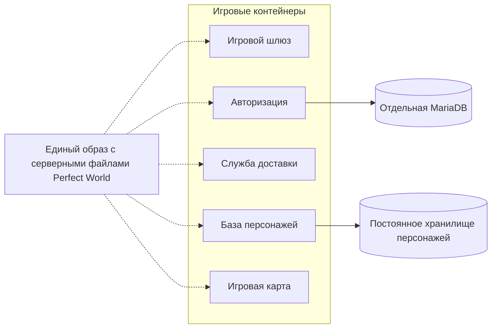

# Ранний вариант архитектуры локального Perfect World

Ранний исследовательский вариант с отдельными контейнерами для служб. Актуальные предложения пользователя о DEB-пакетах и едином игровом контейнере записаны в [отдельной исследовательской заметке](package-architecture-proposal.ru.md).

Один Docker-образ содержит оригинальные серверные файлы игры. Из одного образа запускаются несколько контейнеров с разными командами, каждая под свою игровую службу. Панели управления всегда запускаются в отдельных контейнерах. MariaDB размещается отдельным сервисом.

Каждый игровой контейнер запускает свой процесс с нужным рабочим каталогом и конфигурацией. Адреса межсервисных подключений задаются через сеть контейнеров. Список обязательных процессов, условия готовности и выбор томов требуют отдельных проверок.

Панели получают отдельные образы и контейнеры. Для SQL-доступа достаточно сетевого подключения к MariaDB. Для управления игровыми процессами предстоит выбрать интерфейс. Игровые учётки и веб-роли остаются разными сущностями. При смене хранилища игровых учёток нужно сохранить ожидаемое поведение авторизации и выдачи GM-прав.

## Базовый образ игры

Для первого контейнерного запуска подходит Debian 13 slim на amd64. У проверенных игровых бинарников загрузчик glibc и ссылки на символы `GLIBC_2.34`. Другой образ с glibc возможен при совпадении ABI и наличии всех библиотек. В самом образе нужно проверить доступность `libpcre.so.3` из PCRE1, `libmariadb.so.3`, `libcrypto.so.3` и зависимостей C++. PCRE2 поставляет другой ABI. [Описание пакета PCRE1 в Debian](https://packages.debian.org/bookworm/libpcre3)

Alpine использует musl. Его слой `gcompat` может предоставить путь к загрузчику glibc, а совместимость игровых бинарников и их библиотек требует проверки запуском. Для оценки Alpine нужно поднять весь игровой набор, пройти вход с клиента, загрузить карту и проверить сохранение персонажа после повторного входа. [Пакет gcompat в Alpine](https://pkgs.alpinelinux.org/package/v3.23/main/x86_64/gcompat)
